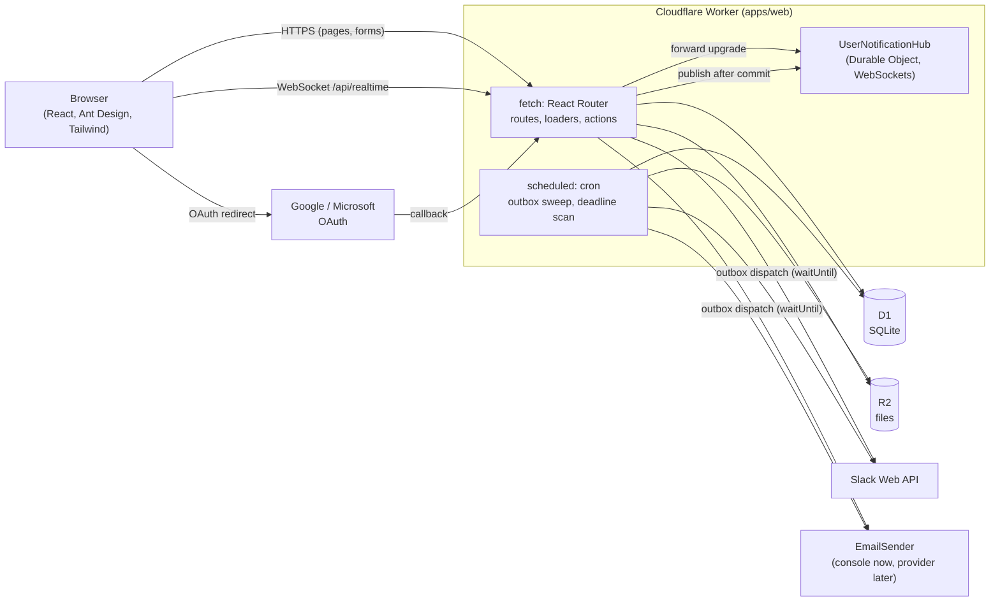
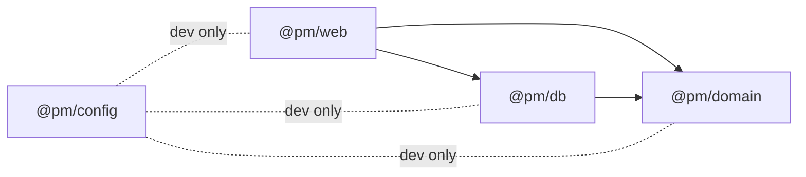
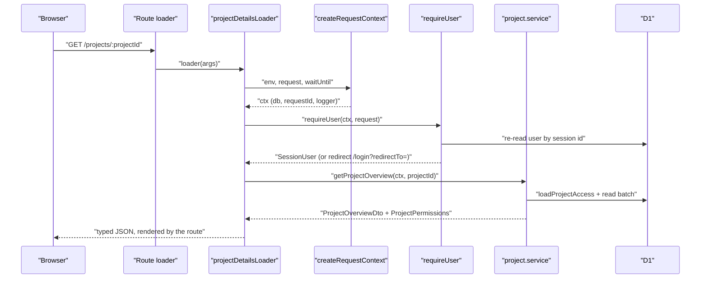
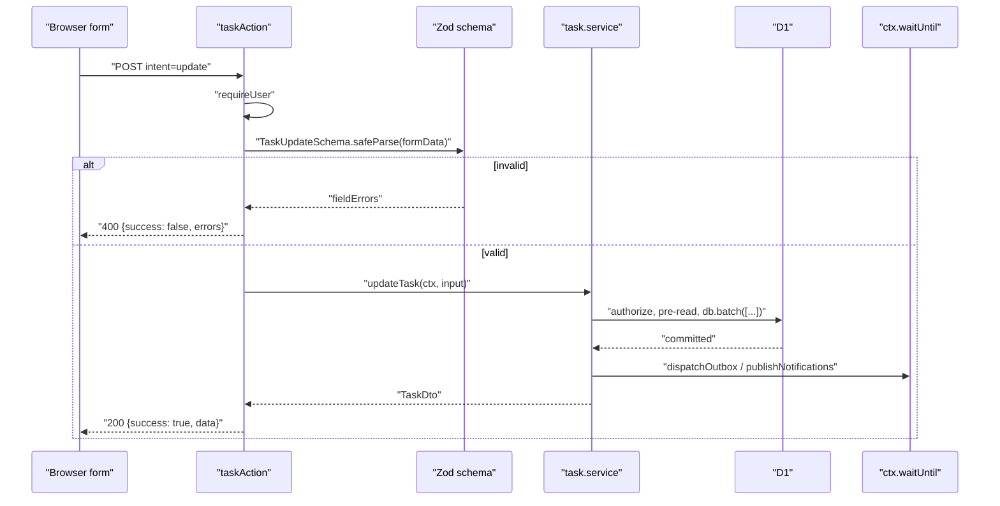

# Architecture

> **Project:** Project & Task Management System
> **Spec:** [Design 2026-11-16](./superpowers/specs/2026-11-16-project-docs-design.md)
> **Related:** [SRS](./01-srs.md) · [Database design](./03-database-design.md) · [Data access & atomicity](./04-data-access-and-atomicity.md) · [RBAC & workflow](./05-rbac-and-workflow.md) · [Dev environment & deployment](./08-dev-environment-and-deployment.md)

---

## 1. System Context

The whole application is **one Cloudflare Worker** running a React Router v8 framework-mode app (Vite with `@cloudflare/vite-plugin`). The same Worker exports three entry points:
- `fetch`: React Router, which serves pages, loaders, actions, and resource routes.
- `scheduled`: the cron trigger.
- `UserNotificationHub`: the Durable Object class.



There is no separate API server, queue broker, or container. Local development runs the same Worker in the real Workers runtime (workerd) through `@cloudflare/vite-plugin`, with local D1, R2, and Durable Objects ([Dev environment](./08-dev-environment-and-deployment.md)).

## 2. Monorepo

pnpm workspaces, with no build orchestrator.

```text
/
├── apps/
│   └── web/                         React Router v8 app (Vite), deployed as ONE Worker
│       ├── app/
│       │   ├── routes/              kebab-case route modules (thin)
│       │   ├── loaders/             *Loader.ts        parse params → call services
│       │   ├── actions/             *Action.ts        Zod safeParse → call services
│       │   ├── services/            *.service.ts      authorization, orchestration, batch assembly
│       │   ├── components/          PascalCase.tsx
│       │   ├── constants/           UPPER_SNAKE_CASE (app-only constants)
│       │   ├── i18n/                en.json, vi.json
│       │   └── utils/               *.server.ts: session, auth, logger, requestContext; client-safe helpers
│       ├── worker/                  index.ts (fetch + scheduled), notificationHub.ts (Durable Object)
│       ├── test/                    Vitest (@cloudflare/vitest-plugin): services, actions
│       ├── e2e/                     Playwright specs
│       └── wrangler.jsonc
├── packages/
│   ├── domain/                      PURE TypeScript (no Cloudflare / Drizzle / React Router imports)
│   │   └── src/                     enums.ts, constants.ts, errors.ts, schemas/ (Zod), policies/,
│   │                                workflow.ts, dates.ts (overdue, due soon), metrics.ts (sprint completion),
│   │                                ports.ts (EmailSender, FileStorage interfaces)
│   ├── db/                          Drizzle schema, migrations, repositories, batch helpers, seed
│   │   ├── src/                     schema/, repositories/, batch.ts, client.ts (AppDatabase type), types.ts
│   │   ├── migrations/
│   │   └── seed/
│   └── config/                      tsconfig.base.json, eslint, prettier, cspell presets
├── docs/
└── .github/workflows/               ci.yml, deploy.yml
```

Package names: `@pm/web`, `@pm/domain`, `@pm/db`, `@pm/config`.

### 2.1 Dependency rule



- `@pm/domain` depends on nothing internal, plus only `zod`. It is unit-tested without any runtime.
- `@pm/db` depends on `@pm/domain` and `drizzle-orm`. It never imports from `@pm/web`.
- `@pm/web` may import both.

**Enforcement:**
- Each package's `package.json` lists only allowed workspace dependencies.
- ESLint `import/no-restricted-paths` zones forbid `packages/domain/**` from importing `drizzle-orm`, `@remix-run/*`, `@cloudflare/*`, or any `@pm/*`, and forbid `packages/db/**` from importing `@pm/web`.
- CI runs `madge --circular --extensions ts packages apps/web/app` and fails on any cycle.

### 2.2 Why one app, not separate frontend and backend apps

React Router loaders and actions *are* the backend, served from the same Worker that renders the UI. Splitting them into a separate API app would add an internal HTTP API, CORS, token passing between apps, and a second deployment, with no benefit at this size. The boundary that matters is between **business rules** and **infrastructure**, and the monorepo draws it with packages:
- `@pm/domain` holds rules: policies, transitions, date and metric definitions, Zod schemas, error classes, port interfaces.
- `@pm/db` holds persistence.
- `@pm/web` holds HTTP, UI, and Cloudflare bindings.

## 3. Layers

| Layer | Location | May | Must not |
| :--- | :--- | :--- | :--- |
| **Route** | `apps/web/app/routes/*.tsx` | Export `loader`/`action` that delegate to `loaders/`/`actions/`; render components | Query the database, check permissions, contain business rules |
| **Loader** | `apps/web/app/loaders/*Loader.ts` | Build the `RequestContext`, call `requireUser`, parse params with Zod, call services, return typed data plus `permissions` | Call repositories directly; write data |
| **Action** | `apps/web/app/actions/*Action.ts` | Build the context, `requireUser`, `safeParse` the form or JSON by `intent`, call one service function, map errors to responses | Call repositories directly; skip Zod; trust `formData.get(...) as string` (review lesson #5) |
| **Service** | `apps/web/app/services/*.service.ts` | Call `loadProjectAccess` and policies, pre-read, validate, assemble batches, enqueue outbox jobs, schedule post-commit work, log | Import Remix (`Request`, `json`, `redirect`); render; call external APIs before commit |
| **Repository** | `packages/db/src/repositories/*.repository.ts` | Build queries and statements against an injected `db` | Import a global client; know about HTTP, sessions, or permissions |
| **Domain** | `packages/domain/src/**` | Pure functions, types, schemas, constants, errors | Perform I/O; import infrastructure |

Server-only modules end in `.server.ts` (e.g. `auth.server.ts`, `session.server.ts`), so the React Router build keeps them out of browser bundles. Secrets are read only from the Worker `env` inside server code. They are never put in loader data or `window.ENV`, except the public `APP_BASE_URL`. File and symbol naming follows [Coding conventions](./guides/coding-conventions.md).

## 4. Request Lifecycle

### 4.1 Loader request



### 4.2 Action request



### 4.3 `RequestContext`

```typescript
// apps/web/app/utils/requestContext.server.ts
export interface RequestContext {
  env: Env;                                  // Worker bindings and vars (type emitted by `wrangler types`)
  db: AppDatabase;                           // drizzle(env.DB, { schema }), created once per request
  user: SessionUser | null;                  // set by requireUser
  requestId: string;                         // cf-ray header, or crypto.randomUUID() locally
  logger: Logger;                            // bound to requestId and userId
  waitUntil: (promise: Promise<unknown>) => void;
  clock: { now(): Date };                    // systemClock in production; a fixed clock in tests
}
```

**How the context reaches loaders (React Router v8).** React Router v8 passes a typed `RouterContextProvider` to loaders and actions, not a plain object.
1. `apps/web/app/utils/requestContext.server.ts` exports `requestContextKey = createContext<RequestContext>()` and `createRequestContext(env, executionCtx, request)`.
2. The Worker entry (`worker/index.ts`) creates `new RouterContextProvider()` for each request, then calls `context.set(requestContextKey, createRequestContext(env, ctx, request))`, and passes the provider to the request handler.
3. Loaders and actions read it with `context.get(requestContextKey)`, and pass it explicitly to every service.

The cron handler builds a `JobContext` with the same shape, minus `user`.

**Dev equals production runtime.** `@cloudflare/vite-plugin` runs the Worker inside workerd during `pnpm dev`. So the Durable Object, WebSocket upgrades, the `scheduled` handler, and every binding behave as in production. `pnpm preview` serves the production *bundle* the same way, and E2E tests run against it. CPU limits are not enforced locally, so CPU measurements (R1) are taken on a deployed dev Worker.

### 4.4 Error model

Errors are defined in `packages/domain/src/errors.ts`:

| Class | HTTP | Typical use |
| :--- | :--- | :--- |
| `AppError(message: string, status: number)` | as given | Base class; never thrown with the comma operator (`throw (new AppError(...), 403)` throws the number 403, see review lesson #4) |
| `ValidationError` | 400 | Business validation not caught by Zod, e.g. "Sprint does not belong to this project". Carries `fieldErrors?: Record<string, string[]>` |
| `UnauthorizedError` | 401 | Realtime upgrade without a session |
| `ForbiddenError` | 403 | Policy refused the action |
| `NotFoundError` | 404 | Missing resource, or project non-member |
| `ConflictError` | 409 | Version guard failed |

A single `handleActionError(error, ctx)` in `apps/web/app/utils/errors.server.ts` maps these to responses:
- Actions respond with `{ success: false, errors: Record<string, string[]>, message?: string }` and the status above. Forms keep their values, and are reset only when `success === true` (review lesson #14).
- Loaders throw `Response` objects that the route's `ErrorBoundary` renders. A 404 renders the same "Not found" page whether or not the resource exists.
- Unknown errors are logged with their stack and returned as 500 "Something went wrong", without internals.

### 4.5 Logging

A structured JSON logger is implemented in `utils/logger.server.ts`. It writes through `console.log`, which Workers Logs captures. Do not use ad-hoc `console.log` anywhere else, and remove debug output before review (pre-push checklist item 3).

| Field | Always | Notes |
| :--- | :--- | :--- |
| `level` | ✅ | `debug`, `info`, `warn`, `error` |
| `msg` | ✅ | Plain English, e.g. "Task approved" |
| `requestId` | ✅ | Ties all lines of one request together |
| `userId` | when signed in | The actor |
| `targetId` / `projectId` / `taskId` | when relevant | The thing acted on (review lesson #16) |
| `durationMs` | on request end | |
| `error` | on errors | `{ name, message, stack }` |

Never log passwords, password hashes, session cookies, invite tokens, OAuth codes, or secrets.

## 5. Runtime Notes

### 5.1 Cloudflare plan

The project targets the **Workers Free plan**. Limits checked on 2026-11-16:

| Limit | Free plan | How the design copes |
| :--- | :--- | :--- |
| CPU time per request / cron | 10 ms | Keep SSR light. Export, PBKDF2, and large tables are measured in M0/M1 (risk R1). |
| D1 queries per invocation | 50 (a batch counts as 1) | Read batches; paginate; the sweep processes at most 20 jobs per tick (risk R2) |
| Subrequests per request | 50 | Outbox dispatch handles a few jobs per request; the cron handles the rest |
| Cron triggers per account | 5 | One trigger per environment (risk R3) |
| D1 storage | 500 MB per database, 10 databases | 3 remote databases plus local (risk R4) |
| Durable Objects | SQLite-backed only | `UserNotificationHub` uses the SQLite backend |

**Upgrade trigger (accepted by the author):** if a limit is consistently hit, in particular password hashing at an acceptable strength not fitting in 10 ms, the affected environment moves to **Workers Paid**. The reason is recorded in [Risks](./11-risks-and-assumptions.md). No code changes are needed. `PBKDF2_DEFAULT_ITERATIONS` is already 100,000, the maximum workerd allows on any plan; the paid plan only adds CPU headroom.

### 5.2 Framework version

Remix v2 is in maintenance mode, and its generator refuses new projects. The author therefore chose **React Router (v8.5, the current release) in framework mode**, which is Remix's successor, with the same loader/action model, on `@cloudflare/vite-plugin` (decision recorded on 2026-11-16, risk R9 closed). Notable differences from the original Remix wording in older material:
- Routes are declared in `app/routes.ts`. `flatRoutes()` from `@react-router/fs-routes` keeps the flat file naming used in [Routes §2](./06-routes-and-actions.md#2-layout-structure).
- Route modules use generated `Route.*` types from `./+types/<route>`.
- The load context is a `RouterContextProvider` (§4.3).

### 5.3 Out of scope

The technology catalog in `nativedocs/04-tech-stack.md` is company-wide. This project does **not** use: Vue.js, Next.js, Babylon.js / Three.js, Express / NestJS, Google Cloud Platform, Docker, MySQL, PostgreSQL, Prisma, or AWS (S3, EC2). Files go to Cloudflare R2, which the catalog lists under cloud storage.

## 6. Exceptions to `AGENTS.md` <a id="agents-md-exceptions"></a>

`AGENTS.md` governs agent and engineering behavior in this repository, except where this table says otherwise. `AGENTS.md` has been updated to reference these exceptions.

| `AGENTS.md` section | Says | In this project | Why |
| :--- | :--- | :--- | :--- |
| §1 Overview | Multi-tenant organization workspaces | **Single organization**; no tenant IDs or isolation | Decision P1 |
| §1.1 Tech stack | Prisma, MySQL/PostgreSQL, AWS/GCP, Docker | **Drizzle ORM, Cloudflare D1, R2, Workers, Durable Objects, Cron Triggers**; no Docker | The author chose an all-Cloudflare, local-first stack |
| §1.2 Layered structure | `src/app/{actions,components,constants,loaders,models,repositories,routes,services,utils}` | `apps/web/app/{actions,components,constants,loaders,routes,services,utils}`; repositories and models (Drizzle-inferred types) in `packages/db/src`; rules, schemas, constants, and errors in `packages/domain/src` | Monorepo (§2) |
| §5.1 Atomic transactions | Interactive `$transaction` with an injected `tx` | Injected `db` is still mandatory. Atomicity comes from `db.batch([...])` assembled in services, with `conflictGuardStmt` after conditional writes ([Data access](./04-data-access-and-atomicity.md)) | D1 has no interactive transactions |
| §5.4 Type safety | `Prisma.UserGetPayload<...>` | Drizzle `InferSelectModel` / `InferInsertModel`, plus named DTO types | Drizzle |
| §5.5 Route protection | Redirect unauthenticated *or unauthorized* users to `/login?redirectTo=` | Unauthenticated users go to `/login?redirectTo=`. Signed-in users who lack permission get **403** (and project non-members get **404**), never a redirect ([RBAC §4](./05-rbac-and-workflow.md#4-layouts)) | Sending a signed-in user to the login page loops or confuses; review lesson #8 is about silent redirects |
| §5.6 Migration charset | `utf8mb4_bin` on MySQL tables | Not applicable: SQLite stores UTF-8. Case rules are explicit: `COLLATE NOCASE` on emails, codes, and status names; binary elsewhere | D1 |
| §6 Checklist #5 | Add variables to `.env.example` | Add them to `.dev.vars.example` and the secrets list in [Dev environment §4](./08-dev-environment-and-deployment.md#4-configuration-and-secrets) | Workers configuration |
| §6 Checklist #12 | Migration scripts specify `utf8mb4_bin` | Migration review: CHECK constraints and partial indexes present, forward-only and additive ([Database §6](./03-database-design.md#6-migrations)) | D1 |
