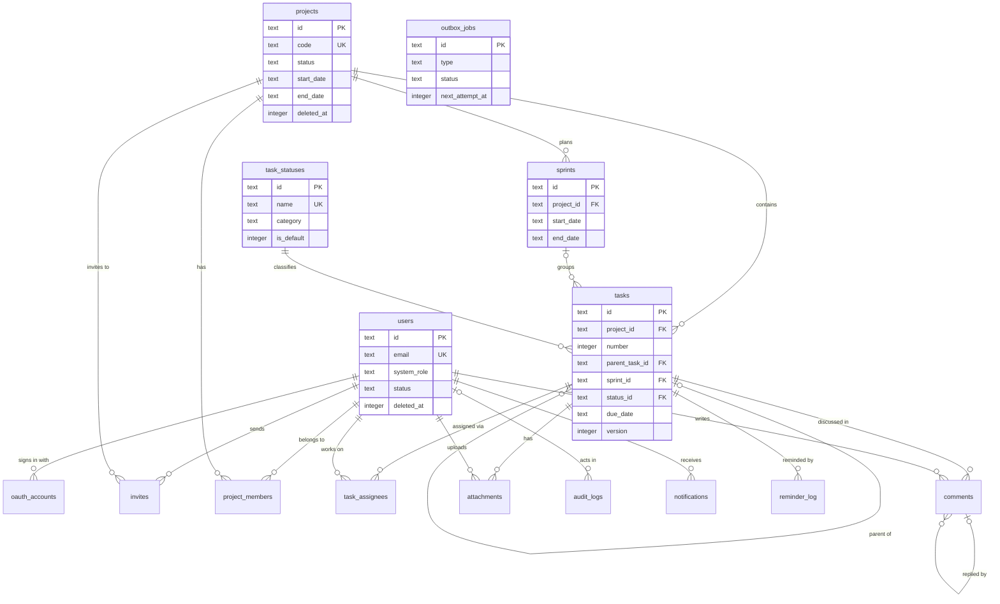

# Database Design

> **Project:** Project & Task Management System
> **Spec:** [Design 2026-11-16](./superpowers/specs/2026-11-16-project-docs-design.md)
> **Related:** [SRS](./01-srs.md) · [Data access & atomicity](./04-data-access-and-atomicity.md) · [RBAC & workflow](./05-rbac-and-workflow.md)

---

## 1. Overview

- **Engine:** Cloudflare D1 (SQLite), accessed only through Drizzle ORM (`drizzle-orm/d1`). Schema and repositories live in `packages/db`.
- **One database per environment:** local, dev, staging, production. See [Dev environment & deployment](./08-dev-environment-and-deployment.md).
- **Naming:** tables and columns are `snake_case` in SQL and `camelCase` in TypeScript. Drizzle maps between them.

### 1.1 Conventions

| Concern | Rule |
| :--- | :--- |
| Primary keys | `text` UUID v4 generated in the Worker with `crypto.randomUUID()`, *before* the batch, so later statements can reference it. Join tables use composite primary keys. |
| Timestamps | `integer` epoch milliseconds (`created_at`, `updated_at`, `deleted_at`, `read_at`, …). Drizzle: `integer({ mode: 'timestamp_ms' })`. |
| Calendar dates | `text` in `YYYY-MM-DD` for date-only fields (`start_date`, `due_date`, `end_date`). They are interpreted in `APP_TIMEZONE` (`Asia/Ho_Chi_Minh`). A task's due date ends at 23:59:59.999 of that day in `APP_TIMEZONE`. |
| Enums | `text` columns with a `CHECK (col IN (...))` constraint, typed in Drizzle with `text({ enum: [...] })`. The value lists come from `packages/domain` constants, so the domain, the schema, and Zod share one source. SQLite has no native enum type. |
| Money | `integer` minor units of `APP_CURRENCY` (`'VND'`, in `packages/domain/src/constants.ts`). Never floating point. |
| Booleans | `integer` 0/1 (`integer({ mode: 'boolean' })`). |
| JSON | `text` holding JSON, typed with `text({ mode: 'json' }).$type<T>()`. |
| Soft delete | A nullable `deleted_at` on `users`, `projects`, `sprints`, `tasks`, and `comments`. Every repository read filters `deleted_at IS NULL` unless the method name says otherwise (e.g. `findByIdIncludingArchived`). |
| Case sensitivity | `users.email`, `invites.email`, `task_statuses.name`, and `projects.code` use `COLLATE NOCASE`. Emails and codes are also normalized (lower-case emails, upper-case codes) before writing. All other text compares as binary. |
| Foreign keys | Declared on every relation and enforced (D1 enforces foreign keys). Deletes are never cascaded, because nothing is hard deleted except `task_assignees`, `project_members`, and `attachments` rows, which are deleted explicitly. |
| Optimistic concurrency | `tasks.version` is an integer that starts at 1 and increments on every task write. Conditional writes use it; see [Data access §3](./04-data-access-and-atomicity.md#3-the-batch-pattern). |

### 1.2 Enumerations

Defined in `packages/domain/src/enums.ts` and reused by the schema.

| Name | Values |
| :--- | :--- |
| `SystemRole` | `MEMBER`, `TEAM_LEAD`, `PM`, `ADMIN` |
| `ProjectRole` | `PM`, `TEAM_LEAD`, `MEMBER` |
| `UserStatus` | `ACTIVE`, `LOCKED` |
| `ProjectStatus` | `ACTIVE`, `ON_HOLD`, `COMPLETED` |
| `StatusCategory` | `TODO`, `IN_PROGRESS`, `REVIEW`, `DONE` |
| `TaskPriority` | `LOW`, `MEDIUM`, `HIGH`, `URGENT` |
| `OAuthProvider` | `GOOGLE`, `MICROSOFT` |
| `AuditEntityType` | `USER`, `PROJECT`, `PROJECT_MEMBER`, `SPRINT`, `TASK`, `ATTACHMENT`, `STATUS` |
| `AuditAction` | `PROJECT_CREATED`, `PROJECT_UPDATED`, `PROJECT_ARCHIVED`, `MEMBER_ADDED`, `MEMBER_REMOVED`, `MEMBER_ROLE_CHANGED`, `TASK_CREATED`, `TASK_UPDATED`, `TASK_STATUS_CHANGED`, `TASK_ASSIGNED`, `TASK_APPROVED`, `TASK_REJECTED`, `TASK_REOPENED`, `TASK_ARCHIVED`, `ATTACHMENT_ADDED`, `ATTACHMENT_REMOVED`, `SPRINT_CREATED`, `SPRINT_UPDATED`, `SPRINT_ARCHIVED`, `USER_CREATED`, `USER_UPDATED`, `USER_LOCKED`, `USER_UNLOCKED`, `USER_DELETED`, `USER_ROLE_CHANGED`, `STATUS_CREATED`, `STATUS_UPDATED`, `STATUS_DELETED` |
| `NotificationType` | `TASK_ASSIGNED`, `TASK_COMMENTED`, `TASK_APPROVED`, `TASK_REJECTED`, `TASK_REOPENED`, `PROJECT_MEMBER_ADDED` |
| `OutboxJobType` | `SLACK_POST_TASK`, `SLACK_UPDATE_THREAD`, `EMAIL_DEADLINE_REMINDER`, `EMAIL_INVITE` |
| `OutboxJobStatus` | `PENDING`, `RUNNING`, `DONE`, `FAILED`, `DEAD`, `SKIPPED` |
| `ReminderKind` | `DUE_SOON`, `OVERDUE` |

## 2. Entity Relationship Diagram



`outbox_jobs` has no foreign keys: its `payload` carries the IDs it needs, so a job survives later archiving of the entity it refers to.

## 3. Tables

Columns are listed as SQL name / Drizzle property. "NN" means `NOT NULL`.

#### `users`

A person who can sign in. Never hard deleted.

| Column | Type | Null | Default | Constraint / note |
| :--- | :--- | :--- | :--- | :--- |
| `id` / `id` | text | NN | | PK |
| `email` / `email` | text | NN | | `UNIQUE`, `COLLATE NOCASE`, stored lower-case |
| `full_name` / `fullName` | text | NN | | 1–100 characters |
| `phone` / `phone` | text | null | | up to 30 characters |
| `department` / `department` | text | null | | free text; only an Admin edits it |
| `avatar_key` / `avatarKey` | text | null | | R2 key `avatars/{userId}`, set by catalog A29 |
| `password_hash` / `passwordHash` | text | null | | base64 PBKDF2-SHA256 output plus salt; null for SSO-only users |
| `password_iterations` / `passwordIterations` | integer | null | | iteration count used for this hash. `CHECK ((password_hash IS NULL) = (password_iterations IS NULL))` |
| `system_role` / `systemRole` | text | NN | `'MEMBER'` | `CHECK IN SystemRole` |
| `status` / `status` | text | NN | `'ACTIVE'` | `CHECK IN UserStatus` |
| `created_at` / `createdAt` | integer | NN | | |
| `updated_at` / `updatedAt` | integer | NN | | |
| `deleted_at` / `deletedAt` | integer | null | | soft delete; a deleted user cannot sign in |

#### `oauth_accounts`

Links a user to a Google or Microsoft identity (FR-02).

| Column | Type | Null | Constraint / note |
| :--- | :--- | :--- | :--- |
| `id` | text | NN | PK |
| `user_id` | text | NN | FK → `users.id` |
| `provider` | text | NN | `CHECK IN OAuthProvider` |
| `provider_account_id` | text | NN | the provider's subject ID; `UNIQUE (provider, provider_account_id)` |
| `created_at` | integer | NN | |

#### `invites`

A pending invitation (FR-37). Only the token's SHA-256 hash is stored here. The invite email job carries the token AES-GCM-sealed with a Worker secret, never in plaintext ([Background jobs §1.4](./07-background-jobs-and-integrations.md#14-contracts)).

| Column | Type | Null | Constraint / note |
| :--- | :--- | :--- | :--- |
| `id` | text | NN | PK; also the idempotency key of its `EMAIL_INVITE` job |
| `email` | text | NN | `COLLATE NOCASE`, lower-case |
| `token_hash` | text | NN | `UNIQUE`; hex SHA-256 of the 32-byte random token |
| `user_id` | text | null | FK → `users.id`, set when an Admin created the account first (FR-03) |
| `project_id` | text | null | FK → `projects.id` |
| `project_role` | text | null | `CHECK IN ProjectRole`; `CHECK ((project_id IS NULL) = (project_role IS NULL))` |
| `invited_by_id` | text | NN | FK → `users.id` |
| `expires_at` | integer | NN | `created_at + TOKEN_INVITE_EXPIRY_MS` (7 days) |
| `accepted_at` | integer | null | set exactly once, in the accept batch |
| `created_at` | integer | NN | |

#### `projects`

| Column | Type | Null | Default | Constraint / note |
| :--- | :--- | :--- | :--- | :--- |
| `id` | text | NN | | PK |
| `code` | text | NN | | `UNIQUE`, `COLLATE NOCASE`, upper-case, `CHECK (length(code) BETWEEN 2 AND 10)`; immutable |
| `name` | text | NN | | 1–150 characters |
| `description` | text | null | | goals and description, up to 10,000 characters |
| `budget` | integer | null | | **minor units** of `APP_CURRENCY` (`VND`, whose minor unit is the dong itself, so the factor is 1; switching to a currency with cents only changes the display factor). `CHECK (budget IS NULL OR budget >= 0)` |
| `start_date` | text | NN | | `YYYY-MM-DD` |
| `end_date` | text | NN | | `CHECK (end_date >= start_date)` |
| `status` | text | NN | `'ACTIVE'` | `CHECK IN ProjectStatus` |
| `slack_channel_id` | text | null | | Slack channel for FR-27/28 |
| `created_by_id` | text | NN | | FK → `users.id` |
| `created_at`, `updated_at` | integer | NN | | |
| `deleted_at` | integer | null | | Archive (FR-09) |

#### `project_members`

| Column | Type | Null | Constraint / note |
| :--- | :--- | :--- | :--- |
| `project_id` | text | NN | FK → `projects.id`; PK part 1 |
| `user_id` | text | NN | FK → `users.id`; PK part 2 |
| `project_role` | text | NN | `CHECK IN ProjectRole` |
| `created_at` | integer | NN | |

Removing a member deletes the row. History survives in `audit_logs`.

#### `sprints`

| Column | Type | Null | Constraint / note |
| :--- | :--- | :--- | :--- |
| `id` | text | NN | PK |
| `project_id` | text | NN | FK → `projects.id`; `UNIQUE (id, project_id)`, which is the target of the tasks composite FK |
| `name` | text | NN | 1–100 characters |
| `start_date` | text | NN | `YYYY-MM-DD` |
| `end_date` | text | NN | `CHECK (end_date >= start_date)` |
| `created_at`, `updated_at` | integer | NN | |
| `deleted_at` | integer | null | Archiving a sprint also sets `tasks.sprint_id = NULL` for its tasks, in the same batch (FR-36) |

#### `task_statuses`

System-wide statuses (FR-20).

| Column | Type | Null | Default | Constraint / note |
| :--- | :--- | :--- | :--- | :--- |
| `id` | text | NN | | PK |
| `name` | text | NN | | `UNIQUE`, `COLLATE NOCASE`, 1–50 characters |
| `category` | text | NN | | `CHECK IN StatusCategory` |
| `position` | integer | NN | | ordering in boards and lists |
| `is_default` | integer | NN | 0 | boolean; partial unique index `uq_task_statuses_default` on `(category) WHERE is_default = 1` |
| `created_at`, `updated_at` | integer | NN | | |

Statuses are hard deleted, and only when unused (FR-20 criterion 3). Because the index allows at most one default per category, changing the default is done in one batch: clear the old default, then set the new one.

#### `tasks`

Top-level tasks and sub-tasks (FR-12–FR-17).

| Column | Type | Null | Default | Constraint / note |
| :--- | :--- | :--- | :--- | :--- |
| `id` | text | NN | | PK; `UNIQUE (id, project_id)`, the target of the sub-task composite FK |
| `project_id` | text | NN | | FK → `projects.id` |
| `number` | integer | NN | | per-project sequence; `UNIQUE (project_id, number)`. The display key is `<project.code>-<number>`, e.g. `CRM-12` |
| `parent_task_id` | text | null | | composite FK `(parent_task_id, project_id) → tasks(id, project_id)`, so a sub-task is always in its parent's project. The service also rejects a parent that itself has a parent (one level). |
| `sprint_id` | text | null | | composite FK `(sprint_id, project_id) → sprints(id, project_id)`, so a task can only join a sprint of its own project. A sub-task's value is always copied from its parent. |
| `status_id` | text | NN | | FK → `task_statuses.id` |
| `title` | text | NN | | 1–200 characters |
| `description` | text | null | | up to 10,000 characters |
| `priority` | text | NN | `'MEDIUM'` | `CHECK IN TaskPriority` |
| `start_date` | text | null | | `YYYY-MM-DD` |
| `due_date` | text | null | | `CHECK (start_date IS NULL OR due_date IS NULL OR due_date >= start_date)` |
| `created_by_id` | text | NN | | FK → `users.id` |
| `slack_thread_ts` | text | null | | Slack message `ts` returned by `SLACK_POST_TASK` |
| `status_changed_at` | integer | NN | | set to `created_at` on insert and to `now` on every status change (A16, A18, A19); used for "in Review longer than 2 days" (FR-31, P21) |
| `completed_at` | integer | null | | set by Approve (A18); cleared by Reopen (A19); used for "completed in range" (FR-30) |
| `version` | integer | NN | 1 | optimistic concurrency |
| `created_at`, `updated_at` | integer | NN | | |
| `deleted_at` | integer | null | | Archive (FR-14); archiving a task also archives its sub-tasks |

**`number` allocation:** the insert computes the number itself, with `INSERT INTO tasks (..., number, ...) SELECT ..., COALESCE(MAX(number), 0) + 1, ... FROM tasks WHERE project_id = ?`. D1 runs a batch as one serialized transaction, so two concurrent creates cannot get the same number. The unique index is the backstop.

#### `task_assignees`

| Column | Type | Null | Constraint / note |
| :--- | :--- | :--- | :--- |
| `task_id` | text | NN | FK → `tasks.id`; PK part 1 |
| `user_id` | text | NN | FK → `users.id`; PK part 2 |
| `assigned_at` | integer | NN | |

"Assignees must be project members" (FR-15) is checked in the service before the batch. Removing a member deletes their assignee rows on unarchived tasks in the same batch (FR-10).

#### `comments`

| Column | Type | Null | Constraint / note |
| :--- | :--- | :--- | :--- |
| `id` | text | NN | PK |
| `task_id` | text | NN | FK → `tasks.id` |
| `author_id` | text | NN | FK → `users.id` |
| `parent_comment_id` | text | null | FK → `comments.id`; always a *root* comment (the service re-points a reply-to-reply to the root) |
| `body` | text | NN | 1–5,000 characters |
| `created_at`, `updated_at` | integer | NN | |
| `deleted_at` | integer | null | a deleted comment renders "Comment deleted"; its replies remain |

Rejection and reopen reasons (FR-23) are stored as root comments, written by the lead in the same batch.

#### `attachments`

| Column | Type | Null | Constraint / note |
| :--- | :--- | :--- | :--- |
| `id` | text | NN | PK |
| `task_id` | text | NN | FK → `tasks.id` |
| `uploaded_by_id` | text | NN | FK → `users.id` |
| `file_name` | text | NN | original name, 1–255 characters, sanitized |
| `content_type` | text | NN | as sent, checked against an allow-list |
| `size_bytes` | integer | NN | `CHECK (size_bytes BETWEEN 1 AND 10485760)`, i.e. `MAX_ATTACHMENT_BYTES` |
| `storage_key` | text | NN | `UNIQUE`; `projects/{projectId}/tasks/{taskId}/{attachmentId}` |
| `created_at` | integer | NN | |

Deleting an attachment removes the row (audited as `ATTACHMENT_REMOVED`) and then the R2 object, after commit.

#### `audit_logs`

Append-only history (FR-24). Rows are never updated or deleted.

| Column | Type | Null | Constraint / note |
| :--- | :--- | :--- | :--- |
| `id` | text | NN | PK |
| `actor_id` | text | null | FK → `users.id`; null for system actions |
| `action` | text | NN | `CHECK IN AuditAction` |
| `entity_type` | text | NN | `CHECK IN AuditEntityType` |
| `entity_id` | text | NN | ID of the changed row (for `PROJECT_MEMBER`, `"{projectId}:{userId}"`) |
| `project_id` | text | null | FK → `projects.id`; set for everything inside a project, so task history can be scoped |
| `changes` | text (JSON) | null | `{ [field]: { from: unknown, to: unknown } }`, never containing secrets or password hashes |
| `created_at` | integer | NN | |

#### `notifications`

The user's notification center (FR-25). This table is the source of truth; realtime push is best effort.

| Column | Type | Null | Constraint / note |
| :--- | :--- | :--- | :--- |
| `id` | text | NN | PK |
| `user_id` | text | NN | FK → `users.id`, the recipient |
| `type` | text | NN | `CHECK IN NotificationType` |
| `entity_id` | text | NN | task ID, or project ID for `PROJECT_MEMBER_ADDED` |
| `project_id` | text | NN | FK → `projects.id`; used to build the link and to re-check access on open |
| `payload` | text (JSON) | NN | `{ title: string; actorName: string; reason?: string }`, used for rendering without extra queries |
| `read_at` | integer | null | |
| `created_at` | integer | NN | |

#### `outbox_jobs`

The transactional outbox. See [Background jobs](./07-background-jobs-and-integrations.md).

| Column | Type | Null | Default | Constraint / note |
| :--- | :--- | :--- | :--- | :--- |
| `id` | text | NN | | PK; also the external idempotency key |
| `type` | text | NN | | `CHECK IN OutboxJobType` |
| `payload` | text (JSON) | NN | | typed per job type in `packages/domain` |
| `status` | text | NN | `'PENDING'` | `CHECK IN OutboxJobStatus` |
| `attempts` | integer | NN | 0 | |
| `next_attempt_at` | integer | NN | | epoch ms; the creation time for a new job |
| `last_error` | text | null | | truncated to 1,000 characters |
| `created_at`, `updated_at` | integer | NN | | `updated_at` is also used to detect stuck `RUNNING` jobs |

#### `reminder_log`

Makes deadline emails idempotent (FR-29).

| Column | Type | Null | Constraint / note |
| :--- | :--- | :--- | :--- |
| `task_id` | text | NN | FK → `tasks.id`; PK part 1 |
| `user_id` | text | NN | FK → `users.id`, the recipient (an assignee); PK part 2 |
| `kind` | text | NN | `CHECK IN ReminderKind`; PK part 3 |
| `due_date` | text | NN | the due date the reminder was for; PK part 4 |
| `sent_at` | integer | NN | |

The scan runs once per `(task, assignee, kind)` candidate. It inserts the `reminder_log` row and the `EMAIL_DEADLINE_REMINDER` outbox job in one batch with `INSERT OR IGNORE`, and enqueues only when the row was new (see [Background jobs §6](./07-background-jobs-and-integrations.md#6-deadline-scan)). Changing a task's due date produces a new key, so reminders are sent again for the new date.

#### `cron_state`

A small key-value store for scheduled work that must resume across ticks.

| Column | Type | Null | Constraint / note |
| :--- | :--- | :--- | :--- |
| `key` | text | NN | PK, e.g. `orphan_sweep_cursor` |
| `value` | text | null | e.g. the R2 `list()` cursor; null when a pass is complete |
| `updated_at` | integer | NN | |

#### `batch_guard`

An always-empty helper table that makes a batch fail when an optimistic-concurrency check fails. See [Data access §3.1](./04-data-access-and-atomicity.md#31-the-version-guard).

| Column | Type | Null | Constraint / note |
| :--- | :--- | :--- | :--- |
| `ok` | integer | NN | `CONSTRAINT version_conflict CHECK (ok = 1)`. The guard statement only ever tries to insert `0`, so any insert fails and rolls back the batch. |

The table has no primary key and no rows, and is not part of the Drizzle relational query API.

## 4. Indexes

Each index exists for a specific query (review lesson #17). Archived rows are excluded from reads, so many indexes start with the columns most queries filter on.

| Index | Table (columns) | Serves |
| :--- | :--- | :--- |
| `uq_users_email` | `users(email)` unique | Login, duplicate check ([FR-01](./01-srs.md#fr-01-login), [FR-03](./01-srs.md#fr-03-user-management)) |
| `idx_users_status_deleted` | `users(deleted_at, status)` | Admin user list, member search ([FR-03](./01-srs.md#fr-03-user-management), [FR-10](./01-srs.md#fr-10-add-project-member)) |
| `uq_oauth_provider_account` | `oauth_accounts(provider, provider_account_id)` unique | SSO callback lookup ([FR-02](./01-srs.md#fr-02-single-sign-on)) |
| `uq_invites_token_hash` | `invites(token_hash)` unique | Invite acceptance ([FR-37](./01-srs.md#fr-37-accept-invite)) |
| `idx_invites_expires` | `invites(accepted_at, expires_at)` | Hourly cleanup of expired invites |
| `uq_projects_code` | `projects(code)` unique | Code uniqueness ([FR-07](./01-srs.md#fr-07-create-project)) |
| `idx_project_members_user` | `project_members(user_id)` | "My projects", access checks, dashboards ([FR-16](./01-srs.md#fr-16-task-list), [FR-33](./01-srs.md#fr-33-personal-dashboard)) |
| `idx_sprints_project` | `sprints(project_id, deleted_at, start_date)` | Sprint list, report ([FR-36](./01-srs.md#fr-36-sprint-management), [FR-31](./01-srs.md#fr-31-project-report)) |
| `uq_task_statuses_default` | `task_statuses(category) WHERE is_default = 1` unique partial | One default per category ([FR-20](./01-srs.md#fr-20-configure-statuses)) |
| `idx_tasks_project_status` | `tasks(project_id, deleted_at, status_id)` | Project task list filtered by status, reports ([FR-16](./01-srs.md#fr-16-task-list), [FR-31](./01-srs.md#fr-31-project-report)) |
| `idx_tasks_project_sprint` | `tasks(project_id, sprint_id, deleted_at)` | Sprint completion ([FR-31](./01-srs.md#fr-31-project-report)) |
| `idx_tasks_parent` | `tasks(parent_task_id)` | Sub-task listing and progress ([FR-17](./01-srs.md#fr-17-sub-tasks)) |
| `idx_tasks_due` | `tasks(due_date) WHERE deleted_at IS NULL` partial | Deadline scan, overdue widget, calendar ([FR-29](./01-srs.md#fr-29-deadline-email), [FR-34](./01-srs.md#fr-34-overdue-tasks-widget), [FR-35](./01-srs.md#fr-35-calendar-view)) |
| `idx_tasks_status` | `tasks(status_id, status_changed_at)` | "Status in use" check ([FR-20](./01-srs.md#fr-20-configure-statuses)); stale reviews ([FR-31](./01-srs.md#fr-31-project-report)) |
| `idx_tasks_project_completed` | `tasks(project_id, completed_at)` | Tasks completed in a range ([FR-30](./01-srs.md#fr-30-member-report)) |
| `idx_task_assignees_user` | `task_assignees(user_id)` | My tasks, dashboard, member report ([FR-16](./01-srs.md#fr-16-task-list), [FR-30](./01-srs.md#fr-30-member-report), [FR-33](./01-srs.md#fr-33-personal-dashboard)) |
| `idx_comments_task` | `comments(task_id, created_at)` | Task discussion ([FR-19](./01-srs.md#fr-19-comments)) |
| `idx_attachments_task` | `attachments(task_id)` | Task attachments ([FR-18](./01-srs.md#fr-18-attachments)) |
| `idx_audit_entity` | `audit_logs(entity_type, entity_id, created_at)` | Task history ([FR-24](./01-srs.md#fr-24-audit-log)) |
| `idx_audit_created` | `audit_logs(created_at)` | Admin audit log, newest first ([FR-24](./01-srs.md#fr-24-audit-log)) |
| `idx_notifications_user_read` | `notifications(user_id, read_at, created_at)` | Notification center, unread count, reconnect refetch ([FR-25](./01-srs.md#fr-25-notification-center), [FR-26](./01-srs.md#fr-26-realtime-notifications)) |
| `idx_outbox_status_next` | `outbox_jobs(status, next_attempt_at)` | Outbox sweep ([Background jobs](./07-background-jobs-and-integrations.md)) |

## 5. Drizzle Schema (illustrative)

Condensed to the two tables with composite foreign keys. Every other table follows the reference in §3.

```typescript
// packages/db/src/schema/tasks.ts
import { sqliteTable, text, integer, foreignKey, unique, index } from 'drizzle-orm/sqlite-core';
import type { InferInsertModel, InferSelectModel } from 'drizzle-orm';
import { TASK_PRIORITIES } from '@pm/domain';
import { projects } from './projects';
import { taskStatuses } from './taskStatuses';
import { users } from './users';

export const sprints = sqliteTable('sprints', {
  id: text('id').primaryKey(),
  projectId: text('project_id').notNull().references(() => projects.id),
  name: text('name').notNull(),
  startDate: text('start_date').notNull(),
  endDate: text('end_date').notNull(),
  createdAt: integer('created_at', { mode: 'timestamp_ms' }).notNull(),
  updatedAt: integer('updated_at', { mode: 'timestamp_ms' }).notNull(),
  deletedAt: integer('deleted_at', { mode: 'timestamp_ms' }),
}, (t) => [unique('uq_sprints_id_project').on(t.id, t.projectId)]);

export const tasks = sqliteTable('tasks', {
  id: text('id').primaryKey(),
  projectId: text('project_id').notNull().references(() => projects.id),
  number: integer('number').notNull(),
  parentTaskId: text('parent_task_id'),
  sprintId: text('sprint_id'),
  statusId: text('status_id').notNull().references(() => taskStatuses.id),
  title: text('title').notNull(),
  priority: text('priority', { enum: TASK_PRIORITIES }).notNull().default('MEDIUM'),
  dueDate: text('due_date'),
  createdById: text('created_by_id').notNull().references(() => users.id),
  version: integer('version').notNull().default(1),
  deletedAt: integer('deleted_at', { mode: 'timestamp_ms' }),
  // description, startDate, slackThreadTs, createdAt, updatedAt omitted for brevity
}, (t) => [
  unique('uq_tasks_id_project').on(t.id, t.projectId),
  unique('uq_tasks_project_number').on(t.projectId, t.number),
  foreignKey({ columns: [t.sprintId, t.projectId], foreignColumns: [sprints.id, sprints.projectId] }),
  foreignKey({ columns: [t.parentTaskId, t.projectId], foreignColumns: [t.id, t.projectId] }),
  index('idx_tasks_project_status').on(t.projectId, t.deletedAt, t.statusId),
]);

export type TaskRow = InferSelectModel<typeof tasks>;
export type NewTaskRow = InferInsertModel<typeof tasks>;
```

CHECK constraints that Drizzle cannot express for this dialect are added to the generated migration SQL by hand, in the same migration file. The migration review in the [pre-push checklist](./guides/pre-push-checklist.md) confirms they exist.

## 6. Migrations

1. Change the schema in `packages/db/src/schema/*.ts`.
2. Run `pnpm db:generate` (`drizzle-kit generate`). This writes a new SQL file to `packages/db/migrations/`.
3. Review the SQL. Add any CHECK constraints or partial indexes Drizzle did not emit. Never edit a migration that has already been applied anywhere.
4. Apply locally with `pnpm db:migrate:local` (`wrangler d1 migrations apply DB --local`).
5. CI applies migrations per environment before deploying: `wrangler d1 migrations apply DB --env <env> --remote`.

Rules:
- **Forward-only and additive.** A column is added as nullable or with a default. A column or table is removed only after a release has shipped that no longer reads it, so `wrangler rollback` of the Worker stays safe.
- **Data migrations** are separate SQL files with their own number. They are idempotent (`UPDATE … WHERE` the new value is unset).
- SQLite cannot alter constraints in place. Changing a CHECK means the documented rebuild: create the new table, copy the data, drop the old table, rename. This happens in one migration file, with foreign keys deferred during the copy.

## 7. Seed Data

`pnpm db:seed:local` runs `packages/db/seed/seed.ts` against the local D1. It is idempotent: it upserts by natural key.

| Data | Content |
| :--- | :--- |
| Statuses | `To Do` (`TODO`, default), `In Progress` (`IN_PROGRESS`, default), `Review` (`REVIEW`, default), `Done` (`DONE`, default), at positions 1–4 |
| Admin | One `ADMIN` user from `ADMIN_SEED_EMAIL` / `ADMIN_SEED_PASSWORD` in `.dev.vars` |
| Demo users | `pm@example.test` (PM), `lead@example.test` (TEAM_LEAD), `member@example.test` (MEMBER), all with password `Password123!` locally only |
| Demo project | `DEMO`, with the three demo users as project PM, TEAM_LEAD, and MEMBER, one sprint covering the current two weeks, and 6 tasks: at least one per category, one overdue, one with a sub-task |

Remote environments get statuses only. Their first Admin is created by running the seed with `--remote --env <env> --only=statuses,admin`.
