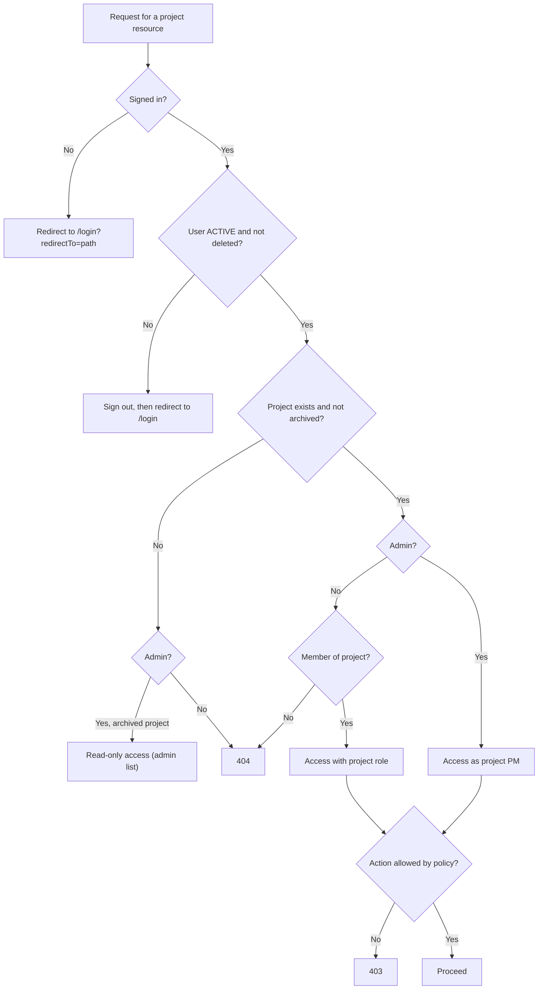
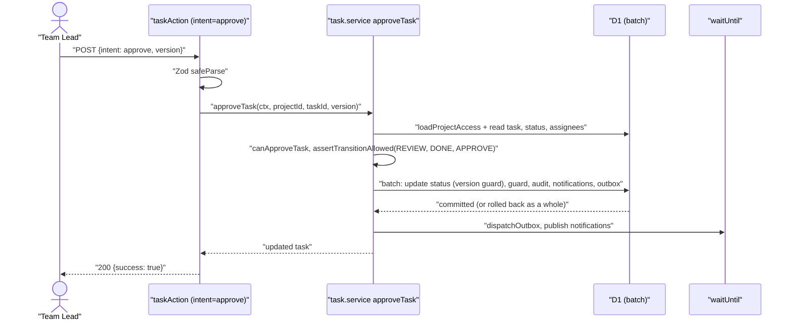
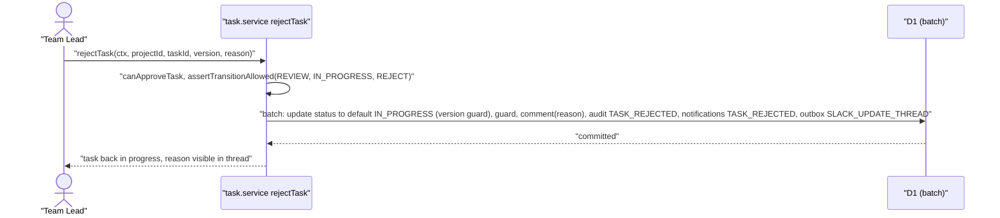

# RBAC and Workflow

> **Project:** Project & Task Management System
> **Spec:** [Design 2026-11-16](./superpowers/specs/2026-11-16-project-docs-design.md)
> **Related:** [SRS](./01-srs.md) · [Database design](./03-database-design.md) · [Data access & atomicity](./04-data-access-and-atomicity.md) · [Routes & actions](./06-routes-and-actions.md)

---

## 1. Roles

| Role kind | Values | Stored in | Decides |
| :--- | :--- | :--- | :--- |
| **System role** | `MEMBER`, `TEAM_LEAD`, `PM`, `ADMIN` | `users.system_role` | The layout, and system-level rights: managing users, statuses, and the audit log; creating projects |
| **Project role** | `PM`, `TEAM_LEAD`, `MEMBER` | `project_members.project_role` | What the user can do *inside* one project |

- **`ADMIN`** has every right everywhere, and behaves as a project `PM` in every project, member or not.
- **System `PM`** can create projects. Inside projects, a system PM has only the rights of their project role, and no access to projects they are not a member of.
- **System `TEAM_LEAD` and `MEMBER`** have no system-level rights beyond their own profile and notifications.
- A user's system role and project role are independent. For example, a system `MEMBER` can be a project `PM`.

## 2. Project Access



Rules:
1. **404, not 403, for non-members.** A non-member cannot tell a project exists. This applies to every project-scoped URL, action, resource route, and notification link. It fixes the WBS 2.0 bug "non-members can view projects".
2. **403** is returned only to a user who *can* see the resource but may not perform the action.
3. The check is made in the **service layer**, through `loadProjectAccess` and the policy functions (§5). Route guards and hidden buttons are conveniences, never the control.

## 3. Permission Matrix

### 3.1 System-level actions

| Action | Policy | FR | MEMBER | TEAM_LEAD | PM | ADMIN |
| :--- | :--- | :--- | :---: | :---: | :---: | :---: |
| Manage users (create, edit, lock, unlock, delete, set system role) | `canManageUsers` | FR-03, FR-04 | ❌ | ❌ | ❌ | ✅ |
| Manage statuses | `canManageStatuses` | FR-20 | ❌ | ❌ | ❌ | ✅ |
| View system audit log | `canViewAuditLog` | FR-24 | ❌ | ❌ | ❌ | ✅ |
| Create project | `canManageProject` (create) | FR-07 | ❌ | ❌ | ✅ | ✅ |
| Own profile, notifications, dashboard, calendar | (signed in) | FR-05, FR-06, FR-25, FR-33–35 | ✅ | ✅ | ✅ | ✅ |

### 3.2 Project-level actions <a id="permission-matrix"></a>

Columns use the actor's role **in this project**. "Creator" and "Assignee" are project `MEMBER`s who created, or are assigned to, the task in question. "Other" is a project `MEMBER` with neither relationship. A project `PM` or `TEAM_LEAD` gets their column's rights whether or not they created or are assigned to the task.

| Action | Policy | FR | Admin | Project PM | Project TEAM_LEAD | MEMBER (creator) | MEMBER (assignee) | MEMBER (other) | Non-member |
| :--- | :--- | :--- | :---: | :---: | :---: | :---: | :---: | :---: | :---: |
| View project, tasks, comments, attachments, task history | `canViewProject` | FR-16, FR-24 | ✅ | ✅ | ✅ | ✅ | ✅ | ✅ | 404 |
| Update project settings / archive project | `canManageProject` | FR-08, FR-09 | ✅ | ✅ | ❌ | ❌ | ❌ | ❌ | 404 |
| Add / remove members, set project roles, invite | `canManageMembers` | FR-10, FR-11, FR-37 | ✅ | ✅ | ❌ | ❌ | ❌ | ❌ | 404 |
| Create task or sub-task | `canCreateTask` | FR-12, FR-17 | ✅ | ✅ | ✅ | ✅ | ✅ | ✅ | 404 |
| Edit task, move between non-Done statuses | `canEditTask` | FR-13, FR-21 | ✅ | ✅ | ✅ | ✅ | ✅ | ❌ | 404 |
| Archive task | `canArchiveTask` | FR-14 | ✅ | ✅ | ✅ | ✅ | ❌ | ❌ | 404 |
| Assign task | `canAssignTask` | FR-15 | ✅ | ✅ | ✅ | ❌ | ❌ | ❌ | 404 |
| Approve / reject task in Review | `canApproveTask` | FR-22, FR-23 | ✅ | ✅ | ✅ | ❌ | ❌ | ❌ | 404 |
| Reopen a Done task | `canReopenTask` | FR-23 | ✅ | ✅ | ✅ | ❌ | ❌ | ❌ | 404 |
| Add comment or attachment | `canViewProject` | FR-18, FR-19 | ✅ | ✅ | ✅ | ✅ | ✅ | ✅ | 404 |
| Delete comment | `canDeleteComment` | FR-19 | ✅ | ✅ | author only | author only | author only | author only | 404 |
| Delete attachment | `canDeleteAttachment` | FR-18 | ✅ | ✅ | uploader only | uploader only | uploader only | uploader only | 404 |
| Create / update / archive sprint | `canManageSprint` | FR-36 | ✅ | ✅ | ✅ | ❌ | ❌ | ❌ | 404 |
| Set a task's sprint | `canEditTask` | FR-36 | ✅ | ✅ | ✅ | ✅ | ✅ | ❌ | 404 |
| Member report | `canViewMemberReport` | FR-30 | ✅ | ✅ | ✅ | ❌ | ❌ | ❌ | 404 |
| Project report | `canViewProjectReport` | FR-31 | ✅ | ✅ | ❌ | ❌ | ❌ | ❌ | 404 |
| Export CSV / Excel | `canExportProject` | FR-32 | ✅ | ✅ | ❌ | ❌ | ❌ | ❌ | 404 |

Additional invariants, enforced in services:
- **No self-lockout.** An Admin cannot lock, delete, or demote themselves. The last Admin cannot be demoted (FR-03, FR-04).
- **At least one project PM.** The last project `PM` cannot be removed or demoted (FR-10, FR-11).
- **Assignees must be current project members** (FR-15).
- An approver may approve a task they are assigned to (assumption A2).

## 4. Layouts

| Layout | Shell component | Home | Who | Navigation |
| :--- | :--- | :--- | :--- | :--- |
| `_admin` | `AdminShell` | `/admin` | system `ADMIN`, `PM` | Dashboard, Projects (all for Admin; own for PM), Users (Admin), Statuses (Admin), Audit log (Admin), My tasks, Notifications, Calendar |
| `_member` | `MemberShell` | `/` | system `TEAM_LEAD`, `MEMBER` | Dashboard, My tasks, My projects, Notifications, Calendar |

The pathless layout route `_app.tsx` selects the shell from the system role. `/admin/*` routes are additionally guarded by `requireSystemRole(['ADMIN', 'PM'])`, and Admin-only pages call their policy. See [Routes §2](./06-routes-and-actions.md#2-layout-structure).

- **Project pages are shared.** `/projects/:projectId/*` renders inside the user's own layout. The page shows controls according to the `permissions` object computed by the loader (§5.3).
- **No session:** redirect to `/login?redirectTo=<path>`, never to `/` (review lesson #8).
- **Signed in but not permitted:** a `_member` user requesting `/admin/*`, or any user posting an action they may not perform, gets **403** and the "You don't have access to this page" error page, with a link to their home. Users are never silently redirected. (Project non-members get 404, §2.) This refines `AGENTS.md` §5.5; see [Architecture §6](./02-architecture.md#agents-md-exceptions).
- **Home routing (not authorization):** `/` is the member dashboard. An `ADMIN` or `PM` opening `/` is sent to their own home, `/admin`.
- A system-role change takes effect on the user's next request, because the user is re-read on every request.

## 5. Policy Functions

Policies are pure functions in `packages/domain/src/policies/`. They have no I/O and no Cloudflare or Drizzle imports, so they are unit-tested directly. Each returns `boolean`. Services convert `false` into `ForbiddenError`.

```typescript
// packages/domain/src/policies/types.ts
export interface ActorContext {
  userId: string;
  systemRole: SystemRole;
  projectRole: ProjectRole | null; // role in the project being acted on; null outside a project
  isProjectArchived: boolean;      // true only for Admin viewing an archived project (others get 404)
}

export interface TaskPolicyTarget {
  createdById: string;
  assigneeIds: readonly string[];
  category: StatusCategory;
}

const isAdmin = (a: ActorContext): boolean => a.systemRole === 'ADMIN';
const isProjectLead = (a: ActorContext): boolean =>
  isAdmin(a) || a.projectRole === 'PM' || a.projectRole === 'TEAM_LEAD';
```

### 5.1 Contracts

| Function | Signature | Rule |
| :--- | :--- | :--- |
| `canManageUsers` | `(actor: ActorContext) => boolean` | Admin |
| `canManageStatuses` | `(actor: ActorContext) => boolean` | Admin |
| `canViewAuditLog` | `(actor: ActorContext) => boolean` | Admin |
| `canViewProject` | `(actor: ActorContext) => boolean` | Admin, or `projectRole !== null` |
| `canManageProject` | `(actor: ActorContext, action: 'create' \| 'update' \| 'archive') => boolean` | `create`: system `PM` or Admin. `update`/`archive`: Admin or project `PM` |
| `canManageMembers` | `(actor: ActorContext) => boolean` | Admin or project `PM` |
| `canCreateTask` | `(actor: ActorContext) => boolean` | `canViewProject` |
| `canEditTask` | `(actor: ActorContext, task: TaskPolicyTarget) => boolean` | project lead (PM/TEAM_LEAD/Admin), creator, or assignee; and `task.category !== 'DONE'` |
| `canArchiveTask` | `(actor: ActorContext, task: TaskPolicyTarget) => boolean` | project lead or creator |
| `canAssignTask` | `(actor: ActorContext) => boolean` | project lead |
| `canApproveTask` | `(actor: ActorContext) => boolean` | project lead (role only; the state check belongs to `assertTransitionAllowed`) |
| `canReopenTask` | `(actor: ActorContext) => boolean` | project lead (role only) |
| `canDeleteComment` | `(actor: ActorContext, comment: { authorId: string }) => boolean` | author, project `PM`, or Admin |
| `canDeleteAttachment` | `(actor: ActorContext, attachment: { uploadedById: string }) => boolean` | uploader, project `PM`, or Admin |
| `canManageSprint` | `(actor: ActorContext) => boolean` | project lead |
| `canViewMemberReport` | `(actor: ActorContext) => boolean` | project lead |
| `canViewProjectReport` | `(actor: ActorContext) => boolean` | Admin or project `PM` |
| `canExportProject` | `(actor: ActorContext) => boolean` | Admin or project `PM` |

`toActor(user, access)` sets `isProjectArchived = access.isArchived`. Every policy except `canManageProject('create')` and the system-level ones assumes the caller already passed `loadProjectAccess`. A non-member never reaches a policy, because they get 404 first.

**Role vs state.** Policies answer "may this person do this kind of thing?", and a failure is **403**. `assertTransitionAllowed` (§6.2) answers "is the task in a state that allows it?", and a failure is **400**, e.g. "Only tasks in review can be approved". Services always call the policy first, then the transition check. So a lead approving a `TODO` task gets 400, and a member approving anything gets 403.

`canEditTask` is the one policy that also reads the category: a `DONE` task is frozen, and editing it returns **403 "Reopen the task to edit it"** (FR-13, FR-21). Comments stay open on DONE tasks (product decision, 2026-11-18).

**Archived projects are read-only.** When `ActorContext.isProjectArchived` is true, every policy except `canViewProject` returns false, for Admin too (FR-09).

### 5.2 Guards

Defined in `apps/web/app/utils/auth.server.ts`.

| Guard | Signature | Behavior |
| :--- | :--- | :--- |
| `requireUser` | `(ctx: RequestContext, request: Request) => Promise<SessionUser>` | Reads the session cookie and **re-reads the user from D1**. If there is no session, it throws a redirect to `/login?redirectTo=<path>`. If the user is `LOCKED` or deleted, it destroys the session and redirects to `/login`. |
| `requireSystemRole` | `(ctx: RequestContext, roles: readonly SystemRole[]) => SessionUser` | Throws `ForbiddenError` (403) when the user's system role is not listed. Used for `/admin/*` routes and system-level actions. |
| `loadProjectAccess` | `(ctx: RequestContext, projectId: string) => Promise<ProjectAccess>` | Returns `{ project, projectRole, isAdmin, isArchived }`. Throws `NotFoundError` when the project does not exist, is archived (unless Admin), or the user is neither a member nor Admin. For Admin, `projectRole` is `'PM'`. |

`ActorContext` is built from `SessionUser` and `ProjectAccess` by `toActor(user, access)`.

### 5.3 Permissions for the UI

Project loaders return a `ProjectPermissions` object, computed by calling the same policies:

```typescript
export interface ProjectPermissions {
  canManageProject: boolean;
  canManageMembers: boolean;
  canManageSprint: boolean;
  canViewMemberReport: boolean;
  canViewProjectReport: boolean;
  canExportProject: boolean;
}
// Task loaders add TaskPermissions: canEditTask, canArchiveTask, canAssignTask,
// canApproveTask (= policy && category === 'REVIEW'), canReopenTask (= policy && category === 'DONE'),
// so buttons only appear when the action would succeed
```

Components read these flags to show or hide controls. They never re-implement a rule.

## 6. Status Workflow <a id="transitions"></a>

### 6.1 Status vs category

- A **status** is an Admin-managed row in `task_statuses` (e.g. "In Progress", "Blocked", "QA"), with a name and a position.
- A **category** is one of four fixed values: `TODO`, `IN_PROGRESS`, `REVIEW`, `DONE`. Every status belongs to exactly one category. A category may have several statuses (for example "In Progress" and "Blocked" both in `IN_PROGRESS`), and exactly one of them is that category's **default**.
- **Business rules read only the category.** Approval, overdue, reports, sprint completion, and the Slack text use the status *name* only for display.

### 6.2 Transitions

| From category | To category | Via | Who (policy) | Notes |
| :--- | :--- | :--- | :--- | :--- |
| `TODO` / `IN_PROGRESS` / `REVIEW` | `TODO` / `IN_PROGRESS` / `REVIEW` (any status) | `UPDATE` | `canEditTask` | Includes moving between statuses of the same category. |
| `TODO` / `IN_PROGRESS` / `REVIEW` | `DONE` | `UPDATE` | nobody | Rejected with 403 "Only an approval can complete a task". |
| `REVIEW` | `DONE` (default status) | `APPROVE` | `canApproveTask` | |
| `REVIEW` | `IN_PROGRESS` (default status) | `REJECT` | `canApproveTask` | Reason required, 1–2,000 characters after trim; saved as a comment. |
| `DONE` | `IN_PROGRESS` (default status) | `REOPEN` | `canReopenTask` | Reason required, same limits. |
| `DONE` | anything | `UPDATE` | nobody | `canEditTask` is false for Done tasks. |
| `TODO` / `IN_PROGRESS` | anything | `APPROVE` / `REJECT` | nobody | 400 "Only tasks in review can be approved" (or "rejected"). |

`assertTransitionAllowed(from: StatusCategory, to: StatusCategory, via: 'UPDATE' | 'APPROVE' | 'REJECT' | 'REOPEN'): void` in `packages/domain/src/workflow.ts` encodes this table and throws `ForbiddenError` or `ValidationError` exactly as listed. Services call it for every status change. The actions never accept a status ID for approve, reject, or reopen: the target is always the category's default status, looked up in the service.

### 6.3 Approve and reject





Reopen follows the reject diagram, with `canReopenTask`, `REOPEN`, and `TASK_REOPENED`.

### 6.4 Status administration rules

| Operation | Rule |
| :--- | :--- |
| Create | Name is unique (case-insensitive), 1–50 characters. The category is required. A new status is never default unless chosen. |
| Rename / reorder | Always allowed. |
| Set default | In one batch: clear the category's current default, then set the new one. The partial unique index guarantees one default per category. |
| Change category | Allowed only when no task, archived ones included, uses the status. Otherwise 400 "This status is in use by N tasks". |
| Delete | Allowed only when unused and not the category's default. Otherwise 400. |
| Bootstrap | The seed creates one default status per category. The service refuses any operation that would leave a category with no default. |
