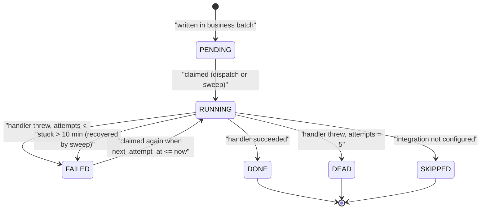
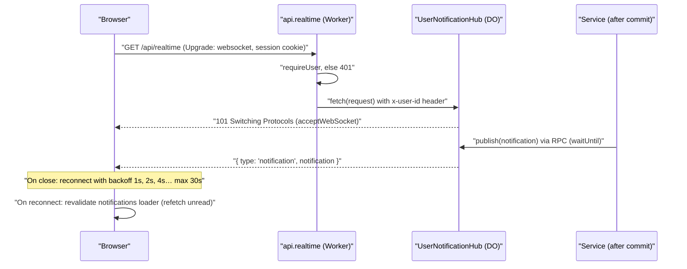

# Background Jobs and Integrations

> **Project:** Project & Task Management System
> **Spec:** [Design 2026-11-16](./superpowers/specs/2026-11-16-project-docs-design.md)
> **Related:** [Database design](./03-database-design.md) · [Data access & atomicity](./04-data-access-and-atomicity.md) · [Architecture](./02-architecture.md) · [Dev environment & deployment](./08-dev-environment-and-deployment.md)

---

## 1. Transactional Outbox

### 1.1 Why

A Slack post, an email, or a queue message cannot be part of a D1 batch. If the Worker called Slack right after committing, a crash or timeout between the commit and the call would lose the job. If it called Slack *before* committing, a failed batch would leave a Slack message about a change that never happened.

The outbox solves both. Every external side effect is written as an `outbox_jobs` row **inside the same batch** as the business change ([Data access §4](./04-data-access-and-atomicity.md#atomic-operations)). A job therefore exists if and only if the change committed. Delivery happens afterwards and is retried until it succeeds or is declared dead. **Core business operations never wait on, or depend on, job completion.**

### 1.2 Lifecycle



| Status | Meaning |
| :--- | :--- |
| `PENDING` | Written and waiting for its first attempt |
| `RUNNING` | Claimed by exactly one runner |
| `DONE` | Delivered |
| `FAILED` | The last attempt failed, and another will be made at `next_attempt_at` |
| `DEAD` | `OUTBOX_MAX_ATTEMPTS` (5) attempts failed. Logged at `error` level; no further retries. An Admin can see these in the logs, and a later CR can add a re-queue button. |
| `SKIPPED` | The integration is not configured (no Slack token, no channel, or email provider `console` with no recipient). This is a final status, not an error. |

### 1.3 Claim, run, finish

1. **Claim.** `UPDATE outbox_jobs SET status = 'RUNNING', attempts = attempts + 1, updated_at = :now WHERE id = :id AND status IN ('PENDING','FAILED') AND next_attempt_at <= :now`. If `changes() = 0`, someone else holds the job or it is not due, and the runner moves on. D1 serializes writes, so two runners cannot both claim the same job.
2. **Run** the handler for `job.type` (§3), passing `job.id` as the idempotency key.
3. **Finish.**
   - On success: `status = 'DONE'`.
   - On failure: if `attempts < OUTBOX_MAX_ATTEMPTS`, then `status = 'FAILED'`, `last_error = <message, 1,000 characters max>`, and `next_attempt_at = now + OUTBOX_BACKOFF_BASE_MS × 2^(attempts − 1)`, i.e. 1, 2, 4, then 8 minutes. Otherwise `status = 'DEAD'`.
   - Unconfigured: `status = 'SKIPPED'`.
4. **Stuck-job recovery.** A `RUNNING` job whose `updated_at` is older than 10 minutes (the Worker died mid-run) is set back to `FAILED` with `next_attempt_at = now` by the sweep.

### 1.4 Contracts

```typescript
// apps/web/app/services/outbox.service.ts
export type JobHandler = (ctx: JobContext, job: OutboxJob) => Promise<'DONE' | 'SKIPPED'>; // throw to fail
export const jobHandlers: Record<OutboxJobType, JobHandler> = {
  SLACK_POST_TASK: handleSlackPostTask,
  SLACK_UPDATE_THREAD: handleSlackUpdateThread,
  EMAIL_DEADLINE_REMINDER: handleDeadlineEmail,
  EMAIL_INVITE: handleInviteEmail,
};

/** Immediate best-effort attempt right after a commit. Called through ctx.waitUntil. Never throws. */
export async function dispatchOutbox(ctx: RequestContext | JobContext, jobIds: string[]): Promise<void>;

/** Cron: recover stuck jobs, then claim and run up to OUTBOX_SWEEP_LIMIT (20) due jobs. */
export async function sweepOutbox(env: Env, now: Date): Promise<SweepResult>; // { claimed, done, failed, dead, skipped }
```

Job payloads are typed per job type in `packages/domain/src/jobs.ts`, and validated with Zod when read back:

| Type | Payload |
| :--- | :--- |
| `SLACK_POST_TASK` | `{ taskId: string }` |
| `SLACK_UPDATE_THREAD` | `{ taskId: string; fromStatusId: string; toStatusId: string; actorId: string; reasonCommentId?: string }` |
| `EMAIL_DEADLINE_REMINDER` | `{ taskId: string; userId: string; kind: ReminderKind; dueDate: string }` (one job per recipient) |
| `EMAIL_INVITE` | `{ inviteId: string; sealedToken: string }`. The raw token is **never stored in plaintext**. `sealedToken` is the token encrypted with AES-GCM using `INVITE_SEAL_KEY`, which is derived from `SESSION_SECRET` with HKDF (`sealInviteToken` / `unsealInviteToken` in `utils/crypto.server.ts`). A database reader without the Worker secret cannot use it. When the job reaches `DONE`, `DEAD`, or `SKIPPED`, the payload is overwritten with `{ inviteId }`. |

Handlers re-read current data, such as the task title, when they run, so a retried job never sends stale text.

## 2. Scheduled Handler

A single Cron Trigger per environment fires every five minutes: `CRON_SCHEDULE = '*/5 * * * *'`. The Free plan allows 5 triggers per account and there are three deployed environments, so one trigger per environment does all the scheduled work.

```typescript
// apps/web/worker/index.ts (scheduled)
async scheduled(controller: ScheduledController, env: Env, ctx: ExecutionContext) {
  const now = new Date(controller.scheduledTime);
  ctx.waitUntil((async () => {
    if (now.getUTCMinutes() === 0) {              // hourly tasks run first, in sequence
      await runDeadlineScan(env, now);            // §6: enqueues reminder jobs
      await sweepOrphanFiles(env, now);           // projects/ prefix only; resumes from cron_state cursor
      await cleanupExpiredInvites(env, now);      // delete invites expired > 30 days ago
    }
    await sweepOutbox(env, now);                  // delivers due jobs, including reminders enqueued above
  })());
}
```

The hourly work runs **before** the sweep, so reminder jobs enqueued by the scan are delivered in the same tick. Each sub-task is bounded so that one tick stays within the Free plan's 10 ms CPU and 50-query budget: at most 20 jobs, 100 reminder candidates, and 100 R2 objects per tick. Anything left over is picked up on the next tick, because:
- The deadline scan selects only tasks that still lack a reminder (§6), so it never re-selects the same candidates.
- The orphan sweep stores its R2 list cursor in `cron_state` (key `orphan_sweep_cursor`; see [Database design](./03-database-design.md#cron_state)) and resumes from it. It clears the cursor when the listing is complete, so the next pass starts again from the beginning.

**Locally**, with `pnpm dev` (port 5173) or `pnpm preview` (port 4173) running, trigger a tick through the Cloudflare Vite plugin's scheduled-handler endpoint (verify the exact path against the plugin docs in M7-T1):

```bash
curl "http://localhost:5173/cdn-cgi/handler/scheduled?cron=*/5+*+*+*+*"
```

To exercise the hourly branch, add `&scheduledTime=<epoch ms at minute 0>`. Integration tests call `sweepOutbox` and `runDeadlineScan` directly with a fixed `now`.

## 3. Idempotency

The outbox delivers **at least once**: a job can run twice if a Worker dies after the external call but before marking it `DONE`. Every handler is written so that a second run does no harm.

| Job type | Rule |
| :--- | :--- |
| `SLACK_POST_TASK` | If `tasks.slack_thread_ts` is already set, return `DONE` without posting. After posting, store `ts` with a conditional update (`WHERE slack_thread_ts IS NULL`). A double post can only happen if the Worker dies between Slack's response and that update. That is accepted, and logged as a warning. |
| `SLACK_UPDATE_THREAD` | Requires `slack_thread_ts`. If it is still null and a `SLACK_POST_TASK` job for the task is not yet `DONE`, throw a retryable error ("Waiting for the original post"), so the update follows the post (FR-28 criterion 2). If the post is `DEAD`, return `SKIPPED`. If the post was `SKIPPED` (the project had no channel when the task was created) or there is no post job, start the thread now: post the task's root message, store its `ts`, then post the status reply. Only the oldest open update job for the task does this; younger ones retry, so the root is posted once. Sub-tasks never start a thread. |
| `EMAIL_DEADLINE_REMINDER` | Created only when its `reminder_log` row was newly inserted (catalog A27), so each `(taskId, userId, kind, dueDate)` produces at most one job, and one recipient per job. A retry therefore never re-sends to someone who already received it. The job ID is passed to the provider as its idempotency key where supported. |
| `EMAIL_INVITE` | Keyed by `invites.id`. If the invite has already been accepted or has expired, return `SKIPPED`. The handler unseals the token, builds the link, and sends it. The plaintext token exists only in memory. |

## 4. Realtime Notifications

- **Source of truth:** `notifications` rows written inside business batches. The realtime channel only *announces* them.
- **Hub:** `UserNotificationHub`, one SQLite-backed Durable Object per user, addressed by `env.NOTIFICATION_HUB.idFromName(userId)`. It uses the **WebSocket Hibernation API** (`ctx.acceptWebSocket`), so idle connections cost no duration charges.



| Item | Contract |
| :--- | :--- |
| Upgrade route | `GET /api/realtime`. Authenticates with the session cookie, then forwards the request to the user's hub. Responds 401 without a valid session ([FR-26](./01-srs.md#fr-26-realtime-notifications)). |
| Server → client message | `{ type: 'notification'; notification: NotificationDto }` or `{ type: 'unreadCount'; count: number }` |
| Client → server message | `{ type: 'ping' }` only. Answered by `setWebSocketAutoResponse` without waking the object. |
| Publish | `publishNotifications(ctx, ids)`: reads the rows, groups them by recipient, and calls `hub.publish(dto)` (an RPC method) for each. Errors are logged and swallowed. |
| Missed messages | None are lost: on every (re)connect the client refetches unread notifications through the `notifications` loader. |
| Multiple tabs | The hub holds every socket for its user and broadcasts to all of them. |

`NotificationType` values and their triggers:

| Type | Trigger |
| :--- | :--- |
| `TASK_ASSIGNED` | FR-12 (lead assigns on create), FR-15 |
| `TASK_COMMENTED` | FR-19 |
| `TASK_APPROVED` | FR-22 |
| `TASK_REJECTED` | FR-23 reject |
| `TASK_REOPENED` | FR-23 reopen |
| `PROJECT_MEMBER_ADDED` | FR-10 |

## 5. Integrations

### 5.1 Slack

| Item | Value |
| :--- | :--- |
| API | Slack Web API `chat.postMessage` (`https://slack.com/api/chat.postMessage`), with the bot token in `Authorization: Bearer` |
| Configuration | Secret `SLACK_BOT_TOKEN` per environment. `projects.slack_channel_id` per project, set in project settings. Either missing means the job ends `SKIPPED`. |
| New task (FR-27) | Text: `*<CODE>-<number>* <title>` · Priority: `<priority>` · Due: `<dueDate or "none">` · `<APP_BASE_URL>/projects/<id>/tasks/<id>`. The response `ts` is stored as `tasks.slack_thread_ts`. Sub-tasks are not posted. |
| Status change (FR-28) | Posted in the thread (`thread_ts`): `Status: <old name> → <new name> by <actor name>`. Rejections and reopens append `Reason: <reason>`. |
| Errors | A non-`ok` response or HTTP ≥ 500 throws, so the job retries. `channel_not_found` and `not_in_channel` mark the job `SKIPPED` and log a warning. |

### 5.2 Email

```typescript
// packages/domain/src/ports.ts
export interface EmailMessage { to: string; subject: string; text: string; html?: string; idempotencyKey: string }
export interface EmailSender { send(message: EmailMessage): Promise<void> }
```

| Item | Value |
| :--- | :--- |
| Selection | `EMAIL_PROVIDER` var: `console` (default, and the only value implemented now) |
| `ConsoleEmailSender` | Logs `{ msg: 'Email sent (console)', to, subject, idempotencyKey }` at `info` level, plus the text body at `debug`. Never fails. |
| Templates | `invite` (subject "You are invited to <app>"), `dueSoon` ("Task <CODE>-<n> is due <date>"), `overdue` ("Task <CODE>-<n> is overdue"). Plain text plus simple HTML. Language: English (the recipient's language preference is out of scope). |
| Adding a provider later | (1) Implement `EmailSender` in `apps/web/app/services/email/<provider>EmailSender.server.ts`. (2) Add the value to the `EMAIL_PROVIDER` union and the factory `createEmailSender(env)`. (3) Add the provider's API key with `wrangler secret put` and to `.dev.vars.example`. (4) Configure the sending domain at the provider. No other code changes, because all sends go through outbox jobs. |
| Failure isolation | Email is sent only by outbox handlers. A failure retries and can never fail or roll back a business operation (FR-29 criterion 5). |

### 5.3 File storage (R2)

| Item | Value |
| :--- | :--- |
| Binding | `FILES` (an R2 bucket per environment), wrapped as `R2FileStorage implements FileStorage` |
| Keys | Attachments: `projects/{projectId}/tasks/{taskId}/{attachmentId}`. Avatars: `avatars/{userId}`. |
| Limits | `MAX_ATTACHMENT_BYTES` = 10 MB for both. An allow-list of content types (images, PDF, Office documents, text, zip). Each upload's size is checked from `Content-Length` and again while streaming. |
| Access | No public bucket. Downloads stream through `GET /api/attachments/:id` after `canViewProject`. |
| Ordering | Put before the batch, delete after commit, and an hourly orphan sweep ([Data access §5](./04-data-access-and-atomicity.md#5-what-happens-outside-the-batch)) |
| Orphan sweep scope | Lists **only the `projects/` prefix**, comparing keys with `attachments.storage_key`. Avatars (`avatars/{userId}`) are never swept: they are overwritten in place, and their key is recorded in `users.avatar_key` by catalog A29. |

### 5.4 SSO (Google, Microsoft)

| Item | Value |
| :--- | :--- |
| Library | `remix-auth` with OAuth2 strategies for Google and Microsoft (Entra ID, `common` tenant) |
| Secrets | `GOOGLE_CLIENT_ID`, `GOOGLE_CLIENT_SECRET`, `MICROSOFT_CLIENT_ID`, `MICROSOFT_CLIENT_SECRET`. When a provider's pair is missing, its button is hidden (FR-02 criterion 4). |
| Redirect URIs | One registration per environment: `http://localhost:5173/auth/<provider>/callback` (local), and `https://pm-<env>.<account-subdomain>.workers.dev/auth/<provider>/callback` for dev, staging, and production. No custom domain is required. |
| Account linking | By verified email only. Users are never auto-created (FR-02 criterion 2). |

## 6. Deadline Scan

`runDeadlineScan(env: Env, now: Date): Promise<ScanResult>` runs on the hourly tick:

1. Select up to 100 candidate `(task, assignee, kind)` rows, ordered by `due_date` ascending, using `idx_tasks_due`. A candidate's task is not archived, its category is not `DONE`, it has a `due_date`, and it is due soon or overdue per `isDueSoon` / `isOverdue` ([SRS P19](./01-srs.md#3-product-decisions)). `kind` is `OVERDUE` when overdue, otherwise `DUE_SOON`. The query **anti-joins `reminder_log`** on `(task_id, user_id, kind, due_date)`, so pairs that were already reminded are never selected again. Old overdue tasks therefore cannot starve new ones.
2. For each candidate, run catalog A27. This inserts the `reminder_log` row and, only if it was new, an `EMAIL_DEADLINE_REMINDER` job for that one recipient.
3. The `sweepOutbox` that follows in the same tick (§2) delivers the new jobs.

A task whose due date changes gets a new `(taskId, userId, kind, dueDate)` key, so reminders are sent again for the new date (FR-29 criterion 3).

## 7. Upgrade Path: Cloudflare Queues

Queues **is available on the Workers Free plan** (10,000 operations per day, 24-hour message retention; checked 2026-11-16). It is not used in v1, because the outbox, `waitUntil`, and the cron sweep already give durable, retried delivery without a second mechanism.

If job volume or latency outgrows the 5-minute sweep, Queues replaces the *transport* only:
- `dispatchOutbox` sends job IDs to a queue instead of running handlers inline.
- A queue consumer claims and runs jobs with the same claim rule and handlers.
- The cron keeps recovering stuck jobs.

The outbox table stays the source of truth, so no business code changes.
