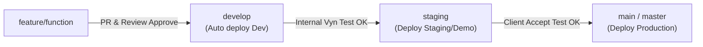
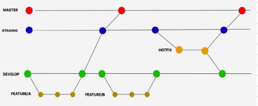

# Git Flow and GitHub Rulebook

> **Source:** [`nativedocs/05-git-flow.md`](../nativedocs/05-git-flow.md) (sheet `Git flow` in `Tài liệu cho intern_Hoành_Anh.xlsx`)
> **Applies to:** all developers, interns, and software projects at Vyn Tech.

---

## 1. Main Branches and Deploy Flow

### Core branches

The standard repository keeps three long-lived branches:

1. **`develop`**
   - The integration branch where the internal Vyn team tests features.
   - **Auto deploy** with GitHub Actions to the **Develop** environment as soon as a feature branch's Pull Request is approved and merged into `develop`.
2. **`staging`**
   - The branch for the **Staging / UAT** environment, used to demo to the client and for the client's acceptance testing.
   - Deployed only after all code on `develop` has been fully tested by the internal Vyn team (tests pass). Then a PR is created from `develop` into `staging`.
3. **`main` (or `master`)**
   - The branch that reflects **Production**.
   - Never push code to it directly. It is deployed to Production only after the code on `staging` has passed client acceptance and been merged into `main` through a PR.

> **Adapted for this project:** "deploy" means the `deploy.yml` workflow: build with `CLOUDFLARE_ENV=dev|staging|production`, apply D1 migrations, run `wrangler deploy`, then a smoke check on `/api/health`. The environments run on Cloudflare Workers at their default `*.workers.dev` URLs. See [Dev environment & deployment §6](../08-dev-environment-and-deployment.md#6-cicd-github-actions).

### Standard deploy flow

```text
feature/<function> ──(Review & Approve)──> develop ──(Internal Test OK)──> staging ──(Client Test OK)──> main
```



### Branch structure illustration



---

## 2. Detailed GitHub Rulebook

### 2.1 Branching strategy

Every feature, fix, or release branch must follow these naming rules:

| Branch type | Created from | Naming format | Examples | Purpose |
| :--- | :--- | :--- | :--- | :--- |
| **Main branch** | n/a | `main` or `master` | `main` | Always stable; reflects Production; merged only through PRs that passed CI/CD. |
| **Develop branch** | `main` | `develop` | `develop` | Integrates features ready for the next round of testing. |
| **Feature branch** | `develop` | `feature/<feature-name>` | `feature/login-page`<br>`feature/user-profile` | New functionality assigned in the sprint. |
| **Bugfix branch** | `develop` | `fix/<short-description>` | `fix/login-error`<br>`fix/404-page` | Fixing bugs found during internal testing. |
| **Hotfix branch** | `main` | `hotfix/<short-description>` | `hotfix/critical-auth-issue` | Urgent fixes directly on Production after a release. |
| **Release branch** | `develop` | `release/vX.Y.Z` | `release/v1.2.0` | Packaging a version, finishing documentation, and final testing before Production. |

> **Adapted for this project:** the branch name for each task is listed in the [implementation roadmap](../10-implementation-roadmap.md). Before opening a PR, **rebase** onto the latest `develop`; never merge `develop` into your branch (`AGENTS.md` §3.3).

---

### 2.2 Commit and Pull Request rules

#### Commit format (Conventional Commits)

```text
<type>(<scope>): <short description>
```

- **`type`**: the kind of change. It must be one of:
  - `feat`: a new feature
  - `fix`: a bug fix
  - `refactor`: restructuring code without changing external behavior
  - `chore`: build configuration or dependency work
  - `test`: adding or changing unit or integration tests
  - `docs`: documentation or README updates
  - `style`: formatting only (whitespace, semicolons; no logic change)
  - `perf`: performance improvements
  - `ci`: CI/CD script changes
- **`scope`**: the module affected (e.g. `auth`, `profile`, `task`, `billing`, `deps`).
- **`short description`**: in English, with consistent casing, **under 72 characters**, stating the purpose briefly and clearly.

> **Examples:**
> - `feat(auth): add Google OAuth login`
> - `fix(profile): fix avatar upload issue`
> - `refactor(repo): inject db context to support transaction`

> **Adapted for this project:** commit messages, branch names, and PR text must contain no AI or agent names and no `Co-authored-by:` trailers (`AGENTS.md` §0.2, §0.3).

#### Pull Request rules

- **PR size:** keep PRs small (**under 300 lines of code**), so colleagues can review them carefully and find defects quickly.
- **Issue link:** always reference the related issue in the description (e.g. `Closes #123` or `Resolves #456`).
- **No direct pushes:** pushing directly to `develop`, `staging`, or `main` is forbidden. Every change goes through a Pull Request.
- **Approval:** at least **1 to 2 reviewers** must approve before a PR can be merged.
- **Automated tests:** every CI/CD check must be **Passed (green)** before requesting review.
- **Standard template:** see the PR template in [PR review rules](./pr-review-rules.md#3-standard-pr-template). The original links to the company template at `vyn-tech-dev/vyn-core/.github/PULL_REQUEST_TEMPLATE.md`.

---

### 2.3 Code review guidelines

#### Reviewer responsibilities
- Read the business requirement and acceptance criteria carefully before looking at the code.
- Check carefully: coding conventions, latent bugs, security holes, memory risks, and performance.
- Ask the author for specific changes when you find a problem. **Never approve casually with just "LGTM" (Looks Good To Me).**
- Give constructive feedback: point to the exact line, explain why it should change, and suggest an alternative.

#### Author responsibilities
- **Never merge your own Pull Request.**
- Respond quickly to reviewer comments.
- Resolve a comment only after pushing the commit that addresses it.

---

### 2.4 CI/CD and testing rules

- Every PR must pass 100% of the automated CI/CD checks.
- **Unit test coverage:** at least **80%** (for the business modules the project requires).
- **Local checks:** run `npm run lint` and `npm run test` on your machine before opening a PR.
- **Standard tooling:**
  - Formatting: `ESLint` + `Prettier`
  - Unit tests: `Vitest` / `Jest`
  - E2E tests: `Cypress` / `Playwright`
  - CI/CD runner: `GitHub Actions` / `GitLab CI` / `Jenkins`

> **Adapted for this project:** the local commands are `pnpm lint`, `pnpm typecheck`, `pnpm spell`, and `pnpm test` (and `pnpm test:e2e` for UI changes). The tools are fixed to ESLint + Prettier, Vitest, Playwright, and GitHub Actions. The 80% coverage gate applies to `packages/domain`, `packages/db`, and `apps/web/app/services` ([Testing strategy](../09-testing-strategy.md)).

---

### 2.5 Security and permissions

- **Never commit secrets:** do not push API keys, client secrets, credentials, or files containing sensitive information (`.env`, `.env.local`) to Git.
- **Branch protection:** set Branch Protection Rules on `main` and `develop` to block force pushes (`git push -f`) and direct pushes that bypass PRs.
- **Two-factor authentication (2FA):** every member must enable 2FA on their personal GitHub account.
- **Standard `.gitignore`:**
  ```gitignore
  # Dependencies
  node_modules/

  # Environment files
  .env
  .env*.local

  # Build outputs
  dist/
  build/
  .cache/

  # Testing & Coverage
  coverage/

  # IDE configurations
  .vscode/
  .idea/
  *.suo
  *.ntvs*
  *.njsproj
  *.sln
  ```

> **Adapted for this project:** also ignore `.dev.vars` (local Worker secrets), `.wrangler/` (local D1/R2/DO state), and `.superpowers/` (local planning scratch). Remote secrets are set only with `wrangler secret put` ([Dev environment §4](../08-dev-environment-and-deployment.md#4-configuration-and-secrets)).
