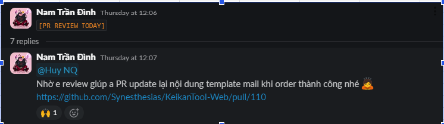
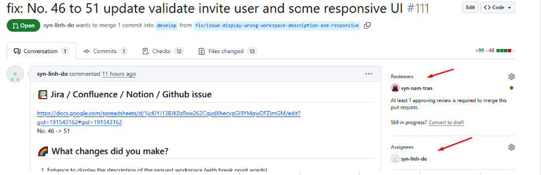

# Pull Request Creation and Review Rules

> **Source:** [`nativedocs/06-pr-review-rules.md`](../nativedocs/06-pr-review-rules.md) (sheet `PR Review Rule` in `Tài liệu cho intern_Hoành_Anh.xlsx`)
> **Applies to:** every member who develops source code on the project.

---

## 1. Reporting a Review Request

Every software project has its own developer channel (Slack / Discord / Teams) for technical discussion and coordinating PR reviews (for example `#keikan-dev`, `#ocr-dev`, …). If your project does not have one yet, ask the Tech Lead or PM to create it.

### Daily thread procedure

When you finish a piece of work (`feature`, `cr`, `bug`, `hotfix`, `refactor`):
1. Check whether the channel already has a discussion thread for today. If not, create today's thread yourself.
2. Post your review request in that thread, in the standard format:

```text
@reviewer
- Short description of the feature/cr/bug/hotfix to review
- Link to the PR to review
```

### Example

A real example of pinging a reviewer in the dev channel:



---

## 2. Settings When Opening a PR on GitHub

When you create a Pull Request on GitHub, you must set two fields in the right-hand sidebar:

1. **Reviewers**
   - Tag the person responsible for reviewing your code (Tech Lead, Senior Developer, or the designated peer reviewer).
2. **Assignees**
   - **The author assigns themselves** (`Assign yourself`).
   - This lets the whole team quickly filter the PRs each person owns, so PRs are not lost and it is always clear who updates a PR when feedback arrives.

### Sidebar illustration



---

## 3. Standard PR Template

Fill in every section of this markdown template when you create a PR. Each project may tailor it to its needs:

```markdown
## 📚 Jira / WBS row / Confluence / Notion / GitHub issue

<!-- Link to the task, issue, or document related to this PR -->
Link:

## 🌈 What changes did you make?

<!-- Describe your changes in technical and business terms -->
-

## 🛂 How did you verify that the changes were implemented as intended?

### What I Checked
<!-- List what you checked and the steps you followed, so the reviewer can reproduce them -->
-

### What I Did Not Check
<!-- List cases or behaviors you did not test (if any), and why -->
<!-- Example: Not checked because the local environment has no real webhook data from the partner. -->
-

### Screenshots
<!-- For UI/UX changes, attach Before / After screenshots or a video -->
___

#### Before

___

#### After


## 😧 Are there any concerns?

<!-- Point out code you are not fully confident about, or want the reviewer to look at closely -->
-

## 🕴 Other

<!-- Any other notes for the team -->
-
```

> **Tip:** create the file `.github/PULL_REQUEST_TEMPLATE.md` in the repository. GitHub then pre-fills this structure every time you click **Create Pull Request**.

> **Adapted for this project:**
> - The first section accepts a **WBS row** (e.g. `wbs.md` 1.15) and the roadmap task ID (e.g. `M3-T2`) when there is no Jira ticket.
> - "What I Checked" lists the commands from the [pre-push checklist](./pre-push-checklist.md) that you ran, and the acceptance check of the roadmap task.
> - **No AI metadata:** PR titles and descriptions must not contain "generated by AI" statements, model or agent names, or bot signatures (`AGENTS.md` §0.2, §3.4).
