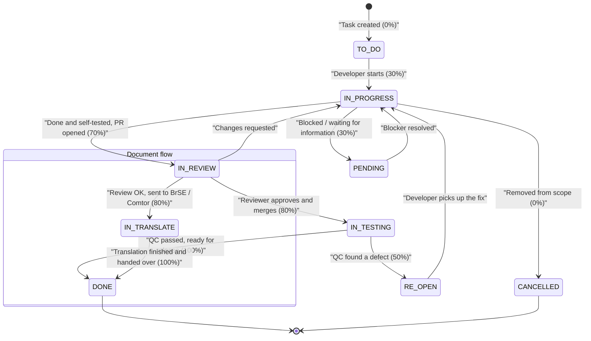

# Task Status Flow and Progress Tracking

> **Source:** [`nativedocs/01-master-status-flow.md`](../nativedocs/01-master-status-flow.md) (sheet `Master` in `Tài liệu cho intern_Hoành_Anh.xlsx`)
> **Main PIC:** Hoàng Anh
> **Purpose:** Standardize the task statuses, their completion percentages, and the rules for moving work through its life cycle.

> **Adapted for this project:** these 9 statuses track the **team's own work** in [`wbs.md`](../wbs.md) (the Status and Progress % columns). They are *not* the statuses of the product being built. The product's task statuses are Admin-configured and grouped into four categories; see [RBAC & workflow §6](../05-rbac-and-workflow.md#transitions).

---

## Task Status Definitions

The 9 standard statuses used in task tracking and WBS reports:

| Sample task | Status | Progress (%) | Meaning and criteria |
| :--- | :--- | :---: | :--- |
| **Task 1** | `TO DO` | **0%** | The task is newly created or not yet started. |
| **Task 2** | `IN PROGRESS` | **30%** | The member has picked up the task and is writing code or working on it. |
| **Task 3** | `IN REVIEW` | **70%** | Coding is finished and the developer has self-tested locally. A PR is open and waiting for reviewer approval. |
| **Task 4** | `IN TESTING` | **80%** | The code review passed and the PR was merged into the test branch (usually `develop` or `staging`). Waiting for QC testing. |
| **Task 5** | `DONE` | **100%** | QC testing passed. The feature is ready for a demo or a release to Production. |
| **Task 6** | `RE-OPEN` | **50%** | For bugs or failed tasks: after the developer's fix, QC re-tested and still found the problem not fully resolved. |
| **Task 7** | `IN TRANSLATE` | **80%** | For handover documents: the technical or business document passed internal review and has been sent to the BrSE / Comtor for translation. |
| **Task 8** | `PENDING` | **30%** | The work is on hold because of an external dependency (missing information, waiting for client confirmation, a blocked partner API, …). **The reason for pending must be noted.** |
| **Task 9** | `CANCELLED` | **0%** | The task was cancelled, removed from the release scope, or no longer fits the business requirements. **The reason for cancellation must be noted.** |

---

## Task Life Cycle

The standard transitions for a normal task, plus the bug and document cases:

---

## Rules and Responsibilities for Developers and Interns

1. **Update statuses promptly.**
   - As soon as you start working on a task, move it from `TO DO` to `IN PROGRESS`.
   - Never leave a task in `TO DO` once code has started being written.
2. **Criteria for `IN REVIEW` (70%):**
   - The developer has finished self-testing in the local environment.
   - The code passes every unit test and the lint check.
   - The PR is created from the correct template and announced in the dev channel ([PR review rules](./pr-review-rules.md)).
3. **Criteria for `RE-OPEN` (50%):**
   - When you receive a `RE-OPEN` task, read the QC comments and reproduction evidence carefully, and talk to QC directly if anything is unclear, before moving it back to `IN PROGRESS` to fix it.
4. **Handling `PENDING` and `CANCELLED`:**
   - Whenever a task is blocked, record the specific reason in the task comment or description, and report it immediately to the Project Manager (`thang.le2`) or the Team Lead.
