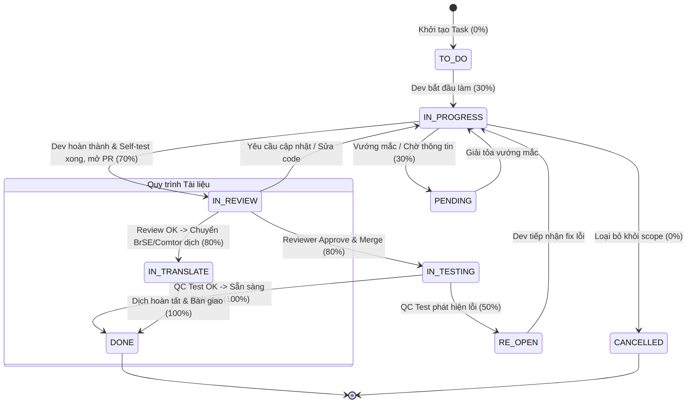

# Quy Trình Trạng Thái & Theo Dõi Tiến Độ (Follow Progress)

> **Tài liệu nguồn**: Sheet `Master` trong `Tài liệu cho intern_Hoành_Anh.xlsx`  
> **Người phụ trách chính (PIC)**: Hoàng Anh  
> **Mục đích**: Chuẩn hóa hệ thống trạng thái công việc (Task Status), tỷ lệ hoàn thành tương ứng và quy định chuyển dịch vòng đời công việc trong dự án.

---

## 📊 Bảng Định Nghĩa Trạng Thái Công Việc

Dưới đây là bảng chuẩn hóa 9 trạng thái công việc áp dụng trên hệ thống quản lý công việc và báo cáo WBS:

| Mã Task Mẫu | Trạng thái (Status) | Tiến độ hoàn thành (%) | Ý nghĩa & Tiêu chí chuyển trạng thái (Description) |
| :--- | :--- | :---: | :--- |
| **Task 1** | `TO DO` | **0%** | Task mới được tạo hoặc chưa bắt đầu thực hiện. |
| **Task 2** | `IN PROGRESS` | **30%** | Thành viên đã bắt đầu nhận việc và đang triển khai viết code/xử lý task. |
| **Task 3** | `IN REVIEW` | **70%** | Đã hoàn thành code và Dev đã tự kiểm thử (self-test) cục bộ. Đã tạo PR và đang chờ Reviewer phê duyệt. |
| **Task 4** | `IN TESTING` | **80%** | Code đã được Review OK, PR đã được merge vào nhánh test (thường là `develop` hoặc `staging`), đang chờ đội QC kiểm thử. |
| **Task 5** | `DONE` | **100%** | QC đã kiểm thử OK, tính năng sẵn sàng để Demo hoặc Release lên môi trường Production. |
| **Task 6** | `RE-OPEN` | **50%** | Áp dụng đối với Bug hoặc Task lỗi: Sau khi Dev fix xong, QC tiến hành kiểm tra lại (re-test) nhưng vẫn phát hiện lỗi chưa khắc phục triệt để. |
| **Task 7** | `IN TRANSLATE` | **80%** | Áp dụng cho tài liệu bàn giao: Tài liệu kỹ thuật/nghiệp vụ đã được review nội bộ OK và được chuyển sang BrSE/Comtor dịch thuật. |
| **Task 8** | `PENDING` | **30%** | Công việc bị tạm hoãn/đình trệ do phụ thuộc bên ngoài (thiếu thông tin, chờ xác nhận từ khách hàng, vướng API đối tác,...). **Bắt buộc phải ghi chú rõ lý do pending.** |
| **Task 9** | `CANCELLED` | **0%** | Task bị hủy bỏ, loại khỏi phạm vi release hoặc không còn phù hợp với yêu cầu nghiệp vụ. **Bắt buộc phải ghi chú rõ nguyên nhân hủy.** |

---

## 🔄 Sơ Đồ Vòng Đời Trạng Thái (Task Life Cycle)

Sơ đồ thể hiện chu trình chuyển đổi trạng thái tiêu chuẩn của một tác vụ thông thường và trường hợp xử lý lỗi/tài liệu:

---

## 📝 Quy Định & Trách Nhiệm Dành Cho Dev / Intern

1. **Cập nhật trạng thái kịp thời**:
   - Khi bắt đầu làm việc trên một task, lập tức chuyển từ `TO DO` sang `IN PROGRESS`.
   - Tuyệt đối không để task ở `TO DO` khi code đã bắt đầu được viết.
2. **Tiêu chí vào `IN REVIEW` (70%)**:
   - Dev phải hoàn thành việc tự kiểm thử (self-test) trên môi trường local.
   - Code phải pass toàn bộ Unit Test và lint check.
   - PR đã được tạo theo đúng template và ping trên kênh dev.
3. **Tiêu chí `RE-OPEN` (50%)**:
   - Khi nhận task trạng thái `RE-OPEN`, đọc kỹ comment/bằng chứng tái hiện từ QC, trao đổi trực tiếp nếu chưa rõ trước khi chuyển về `IN PROGRESS` để sửa lại.
4. **Xử lý `PENDING` & `CANCELLED`**:
   - Bất kỳ khi nào task bị chặn (block), phải cập nhật lý do cụ thể vào comment/mô tả task và báo cáo ngay với Project Manager (`thang.le2`) hoặc Team Lead.
