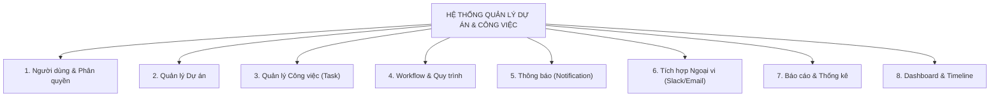

# Đặc Tả Yêu Cầu Chức Năng Hệ Thống (Project Requirements)

> **Tài liệu nguồn**: Sheet `Project` trong `Tài liệu cho intern_Hoành_Anh.xlsx`  
> **Tên hệ thống**: **HỆ THỐNG QUẢN LÝ DỰ ÁN & CÔNG VIỆC** (Project & Task Management System)  
> **Mục tiêu**: Xây dựng nền tảng quản lý dự án nội bộ toàn diện, cho phép quản lý thành viên, dự án, tác vụ công việc, quy trình duyệt, thông báo realtime, tích hợp công cụ bên ngoài (Slack, Email) và báo cáo tiến độ.

---

## 🏛️ Tổng Quan Kiến Trúc Phân Hệ Chức Năng

Hệ thống được tổ chức thành 8 phân hệ chức năng nghiệp vụ chính:

---

## 📋 Danh Mục Chi Tiết 35 Yêu Cầu Chức Năng

Dưới đây là đặc tả đầy đủ 35 yêu cầu chức năng được phân theo nhóm chức năng, phân hệ và vai trò truy cập (Role):

### 1. Phân Hệ Người Dùng & Phân Quyền

| STT | Phân hệ | Vai trò (Role) | Chức năng | Mô tả chi tiết |
| :---: | :--- | :--- | :--- | :--- |
| **01** | Xác thực | `All` | **Đăng nhập** | Cho phép người dùng đăng nhập vào hệ thống bằng Email và Mật khẩu (Password). |
| **02** | Xác thực | `All` | **SSO (Single Sign-On)** | Đăng nhập một chạm thông qua các nhà cung cấp định danh doanh nghiệp Google / Microsoft. |
| **03** | User | `Admin` | **CRUD người dùng** | Quản trị tài khoản toàn hệ thống: Tạo mới, chỉnh sửa thông tin, xóa, hoặc khóa/mở khóa tài khoản người dùng. |
| **04** | Role | `Admin` | **Phân quyền** | Gán vai trò hệ thống cho người dùng: `Member`, `Team Lead`, `PM` (Project Manager), `Admin`. |
| **05** | Hồ sơ cá nhân | `All` | **Xem hồ sơ** | Người dùng xem thông tin tài khoản cá nhân, phòng ban và vai trò hiện tại. |
| **06** | Hồ sơ cá nhân | `All` | **Cập nhật hồ sơ** | Cập nhật ảnh đại diện (avatar), số điện thoại, thông tin liên hệ và đổi mật khẩu. |

---

### 2. Phân Hệ Quản Lý Dự Án

| STT | Phân hệ | Vai trò (Role) | Chức năng | Mô tả chi tiết |
| :---: | :--- | :--- | :--- | :--- |
| **07** | Quản lý dự án | `PM, Admin` | **Tạo dự án** | Khởi tạo dự án mới với thông tin mã dự án, tên, mô tả mục tiêu, ngân sách và ngày bắt đầu/kết thúc. |
| **08** | Quản lý dự án | `PM, Admin` | **Cập nhật dự án** | Chỉnh sửa tên dự án, mô tả chi tiết, trạng thái hoạt động và timeline dự án. |
| **09** | Quản lý dự án | `PM, Admin` | **Xoá dự án** | Xóa dự án khỏi hệ thống (hoặc đánh dấu lưu trữ Archive). |
| **10** | Thành viên dự án | `PM, Admin` | **Thêm thành viên** | Tìm kiếm và gán người dùng (User) vào danh sách thành viên dự án. |
| **11** | Thành viên dự án | `PM, Admin` | **Gán vai trò** | Gán vai trò cụ thể theo phạm vi dự án (Project Role) cho từng thành viên. |

---

### 3. Phân Hệ Quản Lý Công Việc (Task & Work Items)

| STT | Phân hệ | Vai trò (Role) | Chức năng | Mô tả chi tiết |
| :---: | :--- | :--- | :--- | :--- |
| **12** | Task | `All` | **Tạo task** | Tạo công việc mới trực thuộc dự án, thiết lập tiêu đề, mô tả, mức độ ưu tiên và deadline. |
| **13** | Task | `All` | **Cập nhật task** | Chỉnh sửa thông tin chi tiết, tiêu đề, nội dung công việc và thời hạn hoàn thành. |
| **14** | Task | `All` | **Xoá task** | Xóa bỏ công việc khỏi dự án khi không còn hiệu lực. |
| **15** | Task | `Team Lead, PM` | **Phân công task** | Gán (Assign) công việc cho một hoặc nhiều thành viên (Member) chịu trách nhiệm thực hiện. |
| **16** | Task | `All` | **Xem danh sách task** | Xem danh sách công việc theo bộ lọc dự án, trạng thái, người thực hiện hoặc mức độ ưu tiên. |
| **17** | Sub-task | `All` | **Tạo sub-task** | Chia nhỏ công việc phức tạp thành các đầu việc nhỏ hơn (Checklist/Sub-tasks) để theo dõi tiến độ chi tiết. |
| **18** | File | `All` | **Đính kèm file** | Tải lên tài liệu, hình ảnh, tài nguyên liên quan trực tiếp vào nội dung task. |
| **19** | Comment | `All` | **Comment task** | Thảo luận, phản hồi, trao đổi thông tin công việc theo dạng chuỗi thảo luận (Thread). |

---

### 4. Phân Hệ Workflow & Quy Trình Duyệt

| STT | Phân hệ | Vai trò (Role) | Chức năng | Mô tả chi tiết |
| :---: | :--- | :--- | :--- | :--- |
| **20** | Trạng thái | `Admin` | **Cấu hình trạng thái** | Cấu hình vòng đời trạng thái của hệ thống: `To Do`, `In Progress`, `Review`, `Done` (hoặc mở rộng thêm). |
| **21** | Trạng thái | `All` | **Chuyển trạng thái** | Thay đổi trạng thái xử lý của công việc theo tiến trình thực tế. |
| **22** | Duyệt task | `Team Lead, PM` | **Approve task** | Phê duyệt công việc đã hoàn thành đạt chuẩn yêu cầu chất lượng. |
| **23** | Duyệt task | `Team Lead, PM` | **Reject task** | Từ chối kết quả công việc chưa đạt chuẩn, yêu cầu làm lại kèm lý do phản hồi. |
| **24** | Audit log | `Admin` | **Lịch sử thay đổi** | Ghi nhận và truy vết toàn bộ lịch sử thay đổi trạng thái, người cập nhật, thời gian chỉnh sửa task. |

---

### 5. Phân Hệ Thông Báo (Notification)

| STT | Phân hệ | Vai trò (Role) | Chức năng | Mô tả chi tiết |
| :---: | :--- | :--- | :--- | :--- |
| **25** | Notification | `All` | **Xem thông báo** | Hiển thị trung tâm thông báo cá nhân (được gán task, có comment mới, task được duyệt/từ chối). |
| **26** | Notification | `System` | **Realtime** | Đẩy thông báo tức thời tới màn hình người dùng thông qua kết nối WebSocket mà không cần reload trang. |

---

### 6. Phân Hệ Tích Hợp Ngoại Vi (Slack & Email)

| STT | Phân hệ | Vai trò (Role) | Chức năng | Mô tả chi tiết |
| :---: | :--- | :--- | :--- | :--- |
| **27** | Slack | `System` | **Gửi task lên Slack** | Tự động bắn tin nhắn thông báo thông tin task mới vào kênh channel Slack của dự án tương ứng. |
| **28** | Slack | `System` | **Update thread** | Tự động cập nhật trạng thái mới nhất của task vào đúng thread trao đổi trên Slack. |
| **29** | Email | `System` | **Gửi email** | Tự động quét và gửi email nhắc nhở khi công việc sắp đến hạn hoặc bị quá hạn (Overdue). |

---

### 7. Phân Hệ Báo Cáo & Thống Kê

| STT | Phân hệ | Vai trò (Role) | Chức năng | Mô tả chi tiết |
| :---: | :--- | :--- | :--- | :--- |
| **30** | Thống kê | `Team Lead` | **Báo cáo member** | Thống kê năng suất, số lượng task hoàn thành, đang làm hoặc trễ hạn theo từng thành viên. |
| **31** | Thống kê | `PM` | **Báo cáo dự án** | Thống kê tổng quan tiến độ dự án, tỷ lệ hoàn thành Sprint và các điểm nghẽn (bottlenecks). |
| **32** | Export | `PM, Admin` | **Export dữ liệu** | Cho phép trích xuất báo cáo dữ liệu dự án/công việc ra định dạng CSV hoặc Excel. |

---

### 8. Phân Hệ Dashboard & Timeline

| STT | Phân hệ | Vai trò (Role) | Chức năng | Mô tả chi tiết |
| :---: | :--- | :--- | :--- | :--- |
| **33** | Tổng quan | `All` | **Dashboard cá nhân** | Màn hình hiển thị nhanh danh sách các task đang làm, task cần ưu tiên trong ngày của cá nhân. |
| **34** | Tổng quan | `All` | **Task quá hạn** | Widget cảnh báo danh sách các công việc đã vượt quá ngày đến hạn (Due date). |
| **35** | Timeline | `All` | **Calendar view** | Xem lịch trình công việc trực quan theo dạng lịch ngày/tuần/tháng (Calendar view). |

---

## 👥 Ma Trận Phân Quyền Vai Trò (Role Matrix)

| Nhóm chức năng | All | Member | Team Lead | PM | Admin | System |
| :--- | :---: | :---: | :---: | :---: | :---: | :---: |
| **Đăng nhập & SSO** | ✅ | ✅ | ✅ | ✅ | ✅ | - |
| **Hồ sơ cá nhân** | ✅ | ✅ | ✅ | ✅ | ✅ | - |
| **CRUD Người dùng & Phân quyền hệ thống** | - | - | - | - | ✅ | - |
| **Tạo, Sửa, Xóa Dự án & Gán thành viên** | - | - | - | ✅ | ✅ | - |
| **Tạo, Sửa, Xóa, Xem Task & Bình luận/File** | ✅ | ✅ | ✅ | ✅ | ✅ | - |
| **Phân công Task cho Member** | - | - | ✅ | ✅ | ✅ | - |
| **Duyệt / Từ chối Task (Approve/Reject)** | - | - | ✅ | ✅ | ✅ | - |
| **Cấu hình Trạng thái & Audit Log** | - | - | - | - | ✅ | - |
| **Xem Thông báo & Dashboard & Calendar** | ✅ | ✅ | ✅ | ✅ | ✅ | - |
| **Đẩy Realtime WebSocket, Slack, Email** | - | - | - | - | - | ✅ |
| **Báo cáo Member** | - | - | ✅ | ✅ | ✅ | - |
| **Báo cáo Dự án & Xuất CSV/Excel** | - | - | - | ✅ | ✅ | - |

> [!NOTE]
> Khi triển khai màn hình giao diện (UI Layout), cần thiết kế tối thiểu 2 layout riêng biệt:
> 1. **Layout Quản Trị (Admin/PM Layout)**: Có đầy đủ menu quản trị người dùng, quản trị dự án, cấu hình hệ thống và xuất báo cáo.
> 2. **Layout Thành Viên (Member Layout)**: Giao diện tinh gọn tập trung vào Dashboard cá nhân, danh sách task được giao, thảo luận và lịch làm việc.
