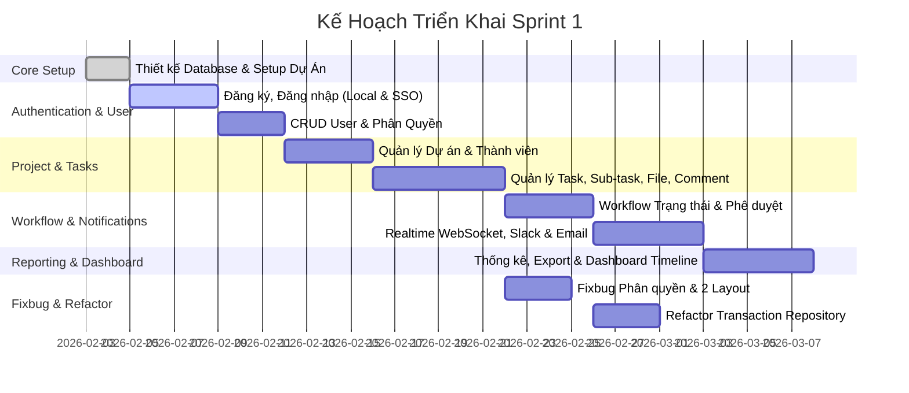

# Kế Hoạch WBS & Tiến Độ Phát Triển (Development Gantt Chart)

> **Tài liệu nguồn**: Sheet `WBS` trong `Tài liệu cho intern_Hoành_Anh.xlsx`  
> **Dự án**: HỆ THỐNG QUẢN LÝ DỰ ÁN & CÔNG VIỆC  
> **Project Manager (PM)**: `thang.le2`  
> **Người thực hiện chính (PIC)**: `Hoàng Anh`  
> **Giai đoạn**: Sprint 1 (Kế hoạch triển khai & Khung thời gian theo dõi)

---

## 🎯 Tổng Quan Phân Rã Công Việc (Work Breakdown Structure)

Bảng WBS phân rã toàn bộ khối lượng công việc của dự án thành 4 nhóm chính:
1. **1.0 Coding**: Phát triển nền tảng Core và các tính năng giao diện Web.
2. **2.0 Fixbug**: Khắc phục các lỗi phân quyền truy cập dự án và tách layout giao diện.
3. **3.0 CR (Change Request)**: Tiếp nhận và xử lý các yêu cầu thay đổi nghiệp vụ.
4. **5.0 Refactor**: Cải tiến kỹ thuật, chuẩn hóa Database và cơ chế Transaction trong Repository.

---

## 📋 Chi Tiết Danh Mục Công Việc Sprint 1

### 1.0 Coding

| Phân loại | Category | Task Title | Chi tiết nghiệp vụ | PIC | Sprint | Kế hoạch Bắt đầu | Kế hoạch Kết thúc | Estimate (H) | Trạng thái | Tiến độ (%) |
| :--- | :--- | :--- | :--- | :---: | :---: | :---: | :---: | :---: | :---: | :---: |
| **Core** | Database | Thiết kế database | Thiết kế ERD, quan hệ bảng và index | Hoàng Anh | Sprint 1 | 2026-02-03 | 2026-02-03 | - | `TO DO` | 0% |
| **Core** | Cấu hình | Setup dự án | Khởi tạo source code, cấu hình Remix, Prisma, ESLint | Hoàng Anh | Sprint 1 | - | - | - | `TO DO` | 0% |
| **WEB** | Xác thực | Đăng ký | Đăng ký bằng email / password | Hoàng Anh | Sprint 1 | - | - | - | `TO DO` | 0% |
| **WEB** | Xác thực | Đăng nhập | Đăng nhập bằng email / password | Hoàng Anh | Sprint 1 | - | - | - | `TO DO` | 0% |
| **WEB** | Xác thực | Đăng nhập | Đăng nhập bằng Google / Microsoft (SSO) | Hoàng Anh | Sprint 1 | - | - | - | `TO DO` | 0% |
| **WEB** | User | CRUD Người dùng | Tạo, sửa, xoá, khoá tài khoản người dùng | Hoàng Anh | Sprint 1 | - | - | - | `TO DO` | 0% |
| **WEB** | Role | Phân quyền | Gán role: Member, Team Lead, PM, Admin | Hoàng Anh | Sprint 1 | - | - | - | `TO DO` | 0% |
| **WEB** | Hồ sơ cá nhân | Xem hồ sơ | Xem thông tin cá nhân | Hoàng Anh | Sprint 1 | - | - | - | `TO DO` | 0% |
| **WEB** | Hồ sơ cá nhân | Cập nhật hồ sơ | Cập nhật avatar, thông tin liên hệ, đổi mật khẩu | Hoàng Anh | Sprint 1 | - | - | - | `TO DO` | 0% |
| **WEB** | Quản lý dự án | Tạo dự án | Tạo mới dự án | Hoàng Anh | Sprint 1 | - | - | - | `TO DO` | 0% |
| **WEB** | Quản lý dự án | Cập nhật dự án | Sửa tên, mô tả, timeline dự án | Hoàng Anh | Sprint 1 | - | - | - | `TO DO` | 0% |
| **WEB** | Quản lý dự án | Xóa dự án | Xóa dự án | Hoàng Anh | Sprint 1 | - | - | - | `TO DO` | 0% |
| **WEB** | Thành viên dự án| Thêm thành viên | Gán user vào dự án | Hoàng Anh | Sprint 1 | - | - | - | `TO DO` | 0% |
| **WEB** | Thành viên dự án| Gán vai trò | Gán role theo dự án | Hoàng Anh | Sprint 1 | - | - | - | `TO DO` | 0% |
| **WEB** | Task | Tạo task | Tạo công việc mới | Hoàng Anh | Sprint 1 | - | - | - | `TO DO` | 0% |
| **WEB** | Task | Cập nhật task | Sửa thông tin task | Hoàng Anh | Sprint 1 | - | - | - | `TO DO` | 0% |
| **WEB** | Task | Xóa task | Xóa công việc | Hoàng Anh | Sprint 1 | - | - | - | `TO DO` | 0% |
| **WEB** | Task | Phân công task | Gán task cho member | Hoàng Anh | Sprint 1 | - | - | - | `TO DO` | 0% |
| **WEB** | Task | Xem danh sách task | Xem task theo dự án | Hoàng Anh | Sprint 1 | - | - | - | `TO DO` | 0% |
| **WEB** | Sub-task | Tạo sub-task | Chia nhỏ công việc | Hoàng Anh | Sprint 1 | - | - | - | `TO DO` | 0% |
| **WEB** | File | Đính kèm file | Upload file trong task | Hoàng Anh | Sprint 1 | - | - | - | `TO DO` | 0% |
| **WEB** | Comment | Comment task | Thảo luận theo thread | Hoàng Anh | Sprint 1 | - | - | - | `TO DO` | 0% |
| **WEB** | Trạng thái | Cấu hình trạng thái | To Do, In Progress, Review, Done | Hoàng Anh | Sprint 1 | - | - | - | `TO DO` | 0% |
| **WEB** | Trạng thái | Chuyển trạng thái | Thay đổi trạng thái | Hoàng Anh | Sprint 1 | - | - | - | `TO DO` | 0% |
| **WEB** | Duyệt task | Approve task | Duyệt task hoàn thành | Hoàng Anh | Sprint 1 | - | - | - | `TO DO` | 0% |
| **WEB** | Duyệt task | Reject task | Từ chối task | Hoàng Anh | Sprint 1 | - | - | - | `TO DO` | 0% |
| **WEB** | Audit log | Lịch sử thay đổi | Lưu log trạng thái task | Hoàng Anh | Sprint 1 | - | - | - | `TO DO` | 0% |
| **WEB** | Notification | Xem thông báo | Danh sách thông báo cá nhân | Hoàng Anh | Sprint 1 | - | - | - | `TO DO` | 0% |
| **WEB** | Notification | Realtime | Thông báo realtime qua websocket | Hoàng Anh | Sprint 1 | - | - | - | `TO DO` | 0% |
| **WEB** | Slack | Gửi task lên slack | Gửi thông tin task | Hoàng Anh | Sprint 1 | - | - | - | `TO DO` | 0% |
| **WEB** | Slack | Update thread | Update trạng thái task | Hoàng Anh | Sprint 1 | - | - | - | `TO DO` | 0% |
| **WEB** | Email | Gửi email | Task sắp đến hạn | Hoàng Anh | Sprint 1 | - | - | - | `TO DO` | 0% |
| **WEB** | Thống kê | Báo cáo member | Task theo thành viên | Hoàng Anh | Sprint 1 | - | - | - | `TO DO` | 0% |
| **WEB** | Thống kê | Báo cáo dự án | Tiến độ dự án | Hoàng Anh | Sprint 1 | - | - | - | `TO DO` | 0% |
| **WEB** | Export | Export dữ liệu | Xuất CSV/ Excel | Hoàng Anh | Sprint 1 | - | - | - | `TO DO` | 0% |
| **WEB** | Tổng quan | Dashboard cá nhân | Task đang làm | Hoàng Anh | Sprint 1 | - | - | - | `TO DO` | 0% |
| **WEB** | Tổng quan | Task quá hạn | Danh sách task trễ | Hoàng Anh | Sprint 1 | - | - | - | `TO DO` | 0% |
| **WEB** | Timeline | Calendar view | Xem task theo ngày | Hoàng Anh | Sprint 1 | - | - | - | `TO DO` | 0% |

---

### 2.0 Fixbug

| Phân loại | Category | Task Title | Chi tiết lỗi / Yêu cầu giải pháp | PIC | Sprint | Trạng thái | Tiến độ (%) |
| :--- | :--- | :--- | :--- | :---: | :---: | :---: | :---: |
| **WEB** | Quản lý dự án | **Lỗi hiển thị dự án** | **Hiện tượng**: Người dùng không phải thành viên dự án nhưng vẫn có thể xem được dự án (Lỗ hổng phân quyền truy cập). | Hoàng Anh | Sprint 1 | `TO DO` | 0% |
| **WEB** | Quản lý dự án | **Tách biệt 2 layout** | **Yêu cầu giải pháp**: Thiết kế và phân chia 2 layout riêng biệt: • `Layout 1`: Dành riêng cho `ADMIN` và `PM` (đầy đủ quyền quản trị). • `Layout 2 (view)`: Dành riêng cho `Member` thông thường. | Hoàng Anh | Sprint 1 | `TO DO` | 0% |

---

### 3.0 Change Request (CR)

| Phân loại | Category | Task Title | Chi tiết yêu cầu | PIC | Sprint | Trạng thái | Tiến độ (%) |
| :--- | :--- | :--- | :--- | :---: | :---: | :---: | :---: |
| *(Dự phòng)* | - | - | Dành để tiếp nhận và theo dõi các yêu cầu phát sinh từ khách hàng/PM trong quá trình phát triển Sprint 1. | Hoàng Anh | Sprint 1 | `TO DO` | 0% |

---

### 5.0 Refactor

| Phân loại | Category | Task Title | Nội dung Refactor kỹ thuật | PIC | Sprint | Trạng thái | Tiến độ (%) |
| :--- | :--- | :--- | :--- | :---: | :---: | :---: | :---: |
| **Core** | Database | **Thiết kế lại database** | Chuẩn hóa lại các bảng quan hệ, ràng buộc khóa ngoại và index tối ưu hóa truy vấn. | Hoàng Anh | Sprint 1 | `TO DO` | 0% |
| **Core** | Cấu hình | **Cấu hình lại repository** | Tái cấu trúc tầng Repository để sử dụng đối tượng `db` (Prisma client / Transaction Client `tx`) được inject từ bên ngoài, đảm bảo hỗ trợ ACID Transaction đồng nhất giữa các repository. | Hoàng Anh | Sprint 1 | `TO DO` | 0% |

---

## 📅 Cấu Trúc Khung Thời Gian Theo Dõi (Gantt Timeline Grid)

Theo thiết kế WBS, tiến độ được theo dõi qua các tuần làm việc (April - May):

### Tổng Kết Định Lượng (Effort Estimation)
- **Công thức tính nỗ lực**:
  - Giờ làm việc tiêu chuẩn: `h/DAY` (8 giờ/ngày).
  - Đơn vị tính: `MD` (Man-Day = 8 giờ), `MM` (Man-Month = 22 Man-Days).
- **Nguyên tắc quản lý**:
  - Mỗi khi kết thúc một ngày làm việc, PIC cần cập nhật chính xác số giờ thực tế đã tiêu tốn (`Actual (H)`) vào bảng theo dõi.
  - Chênh lệch `ET - Actual (H)` phản ánh độ chính xác của ước lượng thời gian và cảnh báo nguy cơ trễ hạn để PM (`thang.le2`) có phương án điều phối kịp thời.
