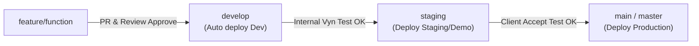
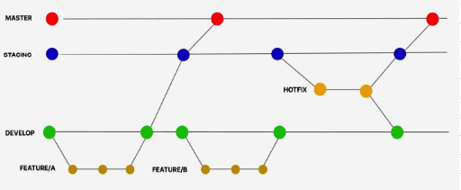

# Quy Trình Git & GitHub Rulebook (Git Flow & Repository Rules)

> **Tài liệu nguồn**: Sheet `Git flow` trong `Tài liệu cho intern_Hoành_Anh.xlsx`  
> **Áp dụng**: Toàn bộ lập trình viên, intern và các dự án phát triển phần mềm thuộc Vyn Tech.

---

## 🌿 1. Quy Tắc Các Branch Chính & Chu Trình Triển Khai (Deploy Flow)

### Hệ Thống Các Nhánh Cốt Lõi
Hệ thống Git repository tiêu chuẩn duy trì 3 nhánh chính dài hạn:

1. **`develop`**:
   - Nhánh tích hợp dành cho đội ngũ phát triển nội bộ Vyn kiểm thử tính năng.
   - Cơ chế: **Auto deploy** bằng GitHub Actions sang môi trường **Develop** ngay khi Pull Request của nhánh chức năng được Approve và Merge vào `develop`.
2. **`staging`**:
   - Nhánh dành cho môi trường **Staging / UAT** để demo cho Khách hàng (KH) và Khách hàng trực tiếp nghiệm thu kiểm thử.
   - Điều kiện: Chỉ được deploy sau khi toàn bộ mã nguồn trên `develop` đã được đội ngũ nội bộ Vyn kiểm thử hoàn chỉnh (Pass test), sau đó tạo PR từ `develop` vào `staging`.
3. **`main` (hoặc `master`)**:
   - Nhánh phản ánh môi trường thực tế **Production**.
   - Điều kiện: Tuyệt đối không push code trực tiếp. Chỉ được deploy lên Production sau khi mã nguồn trên nhánh `staging` đã được khách hàng nghiệm thu thành công và merge vào `main` thông qua PR.

### Chu Trình Triển Khai Tiêu Chuẩn (Deploy Flow)

```text
feature/<function> ──(Review & Approve)──> develop ──(Internal Test OK)──> staging ──(Client Test OK)──> main
```



### Sơ Đồ Cấu Trúc Nhánh Minh Họa



---

## 📖 2. GitHub Rulebook Chi Tiết

### 2.1 Chiến Lược Phân Nhánh (Branching Strategy)

Mọi nhánh tính năng, sửa lỗi hoặc phát hành đều phải tuân thủ nghiêm ngặt quy tắc đặt tên:

| Loại nhánh | Tạo từ nhánh | Quy tắc đặt tên (Format) | Ví dụ cụ thể | Mục đích sử dụng |
| :--- | :--- | :--- | :--- | :--- |
| **Main branch** | - | `main` hoặc `master` | `main` | Luôn ổn định, phản ánh môi trường Production, chỉ merge qua PR đã pass CI/CD. |
| **Develop branch**| `main` | `develop` | `develop` | Tích hợp các tính năng chuẩn bị cho đợt kiểm thử tiếp theo. |
| **Feature branch**| `develop` | `feature/<tên-tính-năng>` | `feature/login-page`<br>`feature/user-profile` | Phát triển chức năng mới được giao theo Sprint. |
| **Bugfix branch** | `develop` | `fix/<mô-tả-ngắn-gọn>` | `fix/login-error`<br>`fix/404-page` | Sửa chữa các bug phát sinh trong quá trình kiểm thử nội bộ. |
| **Hotfix branch** | `main` | `hotfix/<mô-tả-ngắn-gọn>` | `hotfix/critical-auth-issue` | Sửa lỗi khẩn cấp trực tiếp trên môi trường Production sau khi release. |
| **Release branch**| `develop` | `release/vX.Y.Z` | `release/v1.2.0` | Đóng gói phiên bản, hoàn thiện tài liệu và kiểm thử cuối trước khi đưa lên Production. |

---

### 2.2 Quy Chuẩn Commit & Pull Request Rules

#### Định Dạng Commit (Tuân Thủ Chuẩn Conventional Commits)

```text
<type>(<scope>): <mô tả ngắn gọn>
```

- **`type`**: Loại hình thay đổi mã nguồn, bắt buộc thuộc các định danh sau:
  - `feat`: Tính năng mới (Feature)
  - `fix`: Sửa lỗi (Bug fix)
  - `refactor`: Tái cấu trúc code (không đổi tính năng bên ngoài)
  - `chore`: Công việc phụ trợ cấu hình build, dependency
  - `test`: Bổ sung hoặc chỉnh sửa Unit Test / Integration Test
  - `docs`: Cập nhật tài liệu, README
  - `style`: Định dạng code (khoảng trắng, dấu chấm phẩy, không ảnh hưởng logic)
  - `perf`: Cải thiện hiệu năng (Performance)
  - `ci`: Thay đổi cấu hình CI/CD scripts
- **`scope`**: Tên phân hệ hoặc module bị ảnh hưởng (vd: `auth`, `profile`, `task`, `billing`, `deps`).
- **`mô tả ngắn gọn`**: Viết bằng tiếng Anh, viết hoa đầu câu hoặc chữ thường thống nhất, **độ dài dưới 72 ký tự**, diễn đạt ngắn gọn và rõ mục đích.

> **Ví dụ commit chuẩn:**
> - `feat(auth): add Google OAuth login`
> - `fix(profile): fix avatar upload issue`
> - `refactor(repo): inject db context to support transaction`

#### Quy Tắc Tạo & Quản Lý Pull Request (PR)
- **Kích thước PR**: Giữ PR nhỏ gọn (**dưới 300 dòng code**) để đồng nghiệp dễ dàng review kỹ lưỡng, phát hiện lỗi nhanh chóng.
- **Liên kết Issue**: Luôn gắn số ID issue tương ứng trong mô tả (Ví dụ: `Closes #123` hoặc `Resolves #456`).
- **Không push trực tiếp**: Nghiêm cấm hành vi push code trực tiếp vào `develop`, `staging` và `main`. Mọi thay đổi đều phải đi qua Pull Request.
- **Phê duyệt**: Bắt buộc có **ít nhất 1 đến 2 Reviewer** chấp thuận (Approve) mới đủ điều kiện merge.
- **Kiểm thử tự động**: Toàn bộ bài test trên CI/CD phải có trạng thái **Passed (Xanh)** trước khi yêu cầu review.
- **Template chuẩn**: Xem mẫu PR tại [PULL_REQUEST_TEMPLATE.md](https://github.com/vyn-tech-dev/vyn-core/blob/develop/.github/PULL_REQUEST_TEMPLATE.md).

---

### 2.3 Quy Chuẩn Code Review (Code Review Guidelines)

#### Trách Nhiệm Của Reviewer (Người Review)
- Đọc kỹ yêu cầu nghiệp vụ và Acceptance Criteria trước khi bắt đầu xem code.
- Soát kỹ: Coding conventions, bug tiềm ẩn, lỗ hổng bảo mật, nguy cơ tràn bộ nhớ và performance.
- Yêu cầu tác giả chỉnh sửa cụ thể nếu phát hiện vấn đề; **tuyệt đối không được chỉ phê duyệt qua loa bằng từ "LGTM" (Looks Good To Me)**.
- Đưa ra phản hồi mang tính xây dựng, chỉ rõ dòng code và giải thích tại sao nên sửa, gợi ý giải pháp thay thế.

#### Trách Nhiệm Của Author (Tác Giả PR)
- **Tuyệt đối không tự merge Pull Request của chính mình.**
- Phản hồi nhanh chóng các bình luận của Reviewer.
- Đánh dấu resolve comment chỉ sau khi đã push commit sửa chữa tương ứng.

---

### 2.4 Quy Tắc CI/CD & Testing

- Mọi PR bắt buộc phải chạy pass 100% các luồng kiểm tra tự động trên CI/CD.
- **Độ bao phủ Unit Test (Test Coverage)**: Đạt tối thiểu **80%** (đối với các module nghiệp vụ dự án yêu cầu).
- **Kiểm tra cục bộ**: Chạy `npm run lint` và `npm run test` trên máy cá nhân trước khi mở PR.
- **Bộ công cụ chuẩn hóa**:
  - Format code: `ESLint` + `Prettier`
  - Unit Test: `Vitest` / `Jest`
  - E2E Test: `Cypress` / `Playwright`
  - CI/CD Runner: `GitHub Actions` / `GitLab CI` / `Jenkins`

---

### 2.5 Quy Tắc Bảo Mật & Phân Quyền (Security & Permissions)

- **Tuyệt đối không commit bí mật (Secrets)**: Không đẩy API Keys, Client Secrets, Credentials, hoặc file chứa thông tin nhạy cảm (`.env`, `.env.local`) lên Git.
- **Branch Protection**: Thiết lập chế độ bảo vệ nhánh (Branch Protection Rules) trên `main` và `develop` để chặn hành vi push đè (`git push -f`) hoặc push trực tiếp không qua PR.
- **Xác thực 2 yếu tố (2FA)**: Tất cả thành viên bắt buộc kích hoạt tính năng 2FA (Two-Factor Authentication) trên tài khoản GitHub cá nhân.
- **Thiết lập `.gitignore` chuẩn**:
  ```gitignore
  # Dependencies
  node_modules/

  # Environment files
  .env
  .env*.local

  # Build outputs
  dist/
  build/
  .cache/

  # Testing & Coverage
  coverage/

  # IDE configurations
  .vscode/
  .idea/
  *.suo
  *.ntvs*
  *.njsproj
  *.sln
  ```
