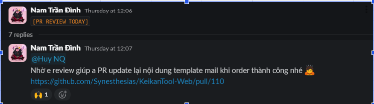
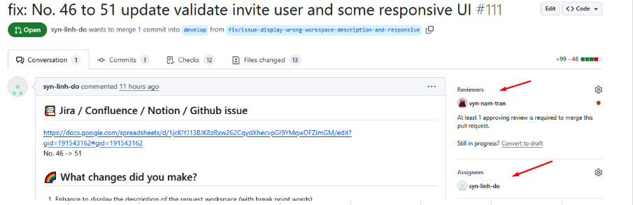

# Quy Tắc Tạo & Review Pull Request (PR Review Rules & Templates)

> **Tài liệu nguồn**: Sheet `PR Review Rule` trong `Tài liệu cho intern_Hoành_Anh.xlsx`  
> **Áp dụng**: Tất cả các thành viên phát triển mã nguồn thuộc dự án.

---

## 📢 1. Quy Tắc Báo Cáo Yêu Cầu Review (Rule Report Review)

Trong mỗi dự án phát triển phần mềm, sẽ luôn có một kênh giao tiếp riêng (Slack / Discord / Teams) dành cho đội ngũ lập trình viên trao đổi kỹ thuật và điều phối review PR (Ví dụ: kênh `#keikan-dev`, `#ocr-dev`,...). Nếu dự án của bạn chưa có kênh này, bạn nên đề xuất Tech Lead hoặc PM tạo mới.

### Quy Trình Báo Cáo Trong Thread Hàng Ngày
Khi hoàn thành một công việc (`feature`, `cr`, `bug`, `hotfix`, `refactor`), lập trình viên thực hiện theo các bước sau:
1. Kiểm tra kênh chat xem đã có thread thảo luận của ngày hôm đó chưa. Nếu chưa có, hãy chủ động tạo thread mới của ngày.
2. Gửi tin nhắn yêu cầu review vào đúng thread với định dạng tiêu chuẩn:

```text
@reviewer 
- Mô tả ngắn gọn về feature/cr/bug/hotfix cần review
- Link đến PR cần review đó
```

### Hình Ảnh Minh Họa Báo Cáo Review Thực Tế

Dưới đây là ví dụ thực tế về cú pháp ping reviewer trong kênh dev:



---

## ⚙️ 2. Quy Tắc Cấu Hình Khi Mở PR Trên GitHub (Rule Tạo PR)

Khi khởi tạo Pull Request trên giao diện GitHub, bạn bắt buộc phải cấu hình chính xác 2 trường quan trọng ở sidebar bên phải:

1. **Reviewers (Người review)**:
   - Gán (tag) đúng người phụ trách review code của bạn (Tech Lead, Senior Dev hoặc Peer Reviewer được chỉ định).
2. **Assignees (Người thực hiện)**:
   - **Tác giả tự gán chính mình vào mục Assignees** (`Assign yourself`).
   - Mục đích: Giúp toàn đội có thể lọc (`filter`) nhanh danh sách các PR do chính bạn đang đảm nhận, tránh tình trạng PR bị thất lạc hoặc không rõ ai là người chịu trách nhiệm cập nhật khi có phản hồi.

### Hình Ảnh Minh Họa Cấu Hình Sidebar PR



---

## 📝 3. Mẫu Nội Dung Pull Request Chuẩn (PR Template)

Khi tạo PR, bạn cần điền đầy đủ thông tin theo mẫu markdown sau đây. Mẫu này có thể được tùy biến linh hoạt tùy theo đặc thù riêng của từng dự án:

```markdown
## 📚 Jira / Confluence / Notion / Github issue

<!-- Vui lòng dẫn link URL của task, issue hoặc tài liệu liên quan đến PR này -->
Link: 

## 🌈 What changes did you make?

<!-- Mô tả chi tiết những thay đổi bạn đã thực hiện ở cấp độ đặc tả kỹ thuật và nghiệp vụ -->
- 

## 🛂 How did you verify that the changes were implemented as intended?

### What I Checked
<!-- Ghi lại danh sách các hạng mục bạn đã kiểm tra và các bước thực hiện để người review có thể dễ dàng tái hiện -->
- 

### What I Did Not Check
<!-- Liệt kê những trường hợp hoặc hành vi chưa được kiểm thử (nếu có) và nêu rõ lý do -->
<!-- Ví dụ: Chưa kiểm tra được do môi trường local không có dữ liệu thực tế từ webhook của đối tác. -->
- 

### Screenshots
<!-- Nếu có thay đổi về giao diện người dùng (UI/UX), vui lòng chụp ảnh hoặc quay video Before / After -->
___

#### Before

___

#### After


## 😧 Are there any concerns?

<!-- Nêu rõ các phần code mà bạn chưa thực sự yên tâm hoặc muốn người review đặc biệt chú ý -->
- 

## 🕴 Other

<!-- Bất kỳ ghi chú hoặc lưu ý kỹ thuật nào khác muốn chia sẻ với đội ngũ -->
- 
```

> [!TIP]
> Bạn nên tạo tệp `.github/PULL_REQUEST_TEMPLATE.md` trực tiếp trong repository của dự án. Khi đó, GitHub sẽ tự động điền sẵn cấu trúc này mỗi khi bạn bấm nút **Create Pull Request**.
