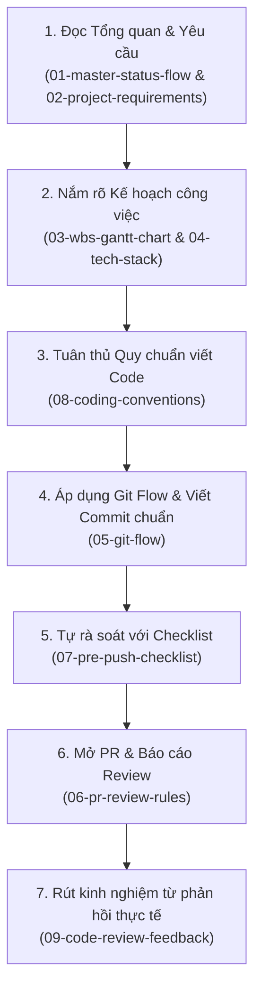

# Tài Liệu Hướng Dẫn & Quy Chuẩn Dự Án Dành Cho Intern

> **Dự án**: Hệ Thống Quản Lý Dự Án & Công Việc (Project & Task Management System)  
> **Người thực hiện (PIC)**: Hoàng Anh  
> **Project Manager (PM)**: thang.le2  
> **Tài liệu nguồn gốc**: `Tài liệu cho intern_Hoành_Anh.xlsx`

---

## 📌 Giới Thiệu Chung

Thư mục tài liệu này được chuyển đổi và hệ thống hóa toàn diện từ sổ tay hướng dẫn công việc `Tài liệu cho intern_Hoành_Anh.xlsx`. Bộ tài liệu cung cấp bức tranh hoàn chỉnh về yêu cầu sản phẩm, quy trình quản lý tiến độ, quy chuẩn kỹ thuật, quy trình Git/CI-CD, checklist kiểm thử, cũng như tổng hợp các phản hồi và bài học kinh nghiệm từ quá trình Code Review thực tế.

---

## 📑 Danh Mục Tài Liệu Chi Tiết

Dưới đây là các tài liệu thành phần được phân chia theo từng nghiệp vụ và quy chuẩn:

| STT | Tài liệu | Mô tả nội dung | Sheet gốc tương ứng |
| :---: | :--- | :--- | :--- |
| **01** | [**01. Quy Trình Trạng Thái & Theo Dõi Tiến Độ**](./01-master-status-flow.md) | Định nghĩa các trạng thái task (`TO DO`, `IN PROGRESS`, `IN REVIEW`, `DONE`,...), tỷ lệ hoàn thành (%), quy tắc chuyển trạng thái và trách nhiệm của dev/intern. | `Master` |
| **02** | [**02. Đặc Tả Yêu Cầu Chức Năng Hệ Thống**](./02-project-requirements.md) | Chi tiết 35 chức năng thuộc 8 phân hệ cốt lõi: Xác thực & Người dùng, Quản lý dự án, Công việc, Workflow, Thông báo realtime, Tích hợp Slack/Email, Báo cáo & Dashboard. | `Project` |
| **03** | [**03. Kế Hoạch WBS & Tiến Độ Phát Triển**](./03-wbs-gantt-chart.md) | Phân rã cấu trúc công việc (WBS) Sprint 1: Coding, Fixbug hiển thị phân quyền layout, Refactor transaction & database. | `WBS` |
| **04** | [**04. Danh Mục Công Nghệ & Hướng Dẫn Tiếp Cận**](./04-tech-stack.md) | Tech Stack chính (React, Remix, Node.js, Prisma, MySQL/PostgreSQL, AWS, Docker,...), liên kết tài liệu chính thức và lộ trình tiếp cận hiệu quả cho Intern. | `Techs` |
| **05** | [**05. Quy Trình Git & GitHub Rulebook**](./05-git-flow.md) | Chiến lược phân nhánh (`develop`, `staging`, `main`), quy chuẩn Conventional Commits, quy tắc mở PR, quy trình CI/CD và bảo mật mã nguồn. | `Git flow` |
| **06** | [**06. Quy Tắc Tạo & Review Pull Request**](./06-pr-review-rules.md) | Quy định ping review trên Slack/Discord dev channels, thiết lập Reviewers & Assignees, và mẫu Pull Request Template chuẩn. | `PR Review Rule` |
| **07** | [**07. Checklist Kiểm Tra Trước Khi Push & Mở PR**](./07-pre-push-checklist.md) | Bộ 13 tiêu chí tự kiểm tra bắt buộc (Self-check) trước khi yêu cầu review: Lint, UT, dead code, environment variables, git rebase, i18n, validation,... | `Checklist` |
| **08** | [**08. Quy Chuẩn Coding Convention & Clean Architecture**](./08-coding-conventions.md) | Quy tắc đặt tên (File, Component, Variable, Action, Loader, Service, Repository, Route), quy chuẩn ESLint/Prettier và SonarQube. | `Coding convention` |
| **09** | [**09. Tổng Hợp Feedback Review & Bài Học Kinh Nghiệm**](./09-code-review-feedback.md) | Bảng thống kê 19 lỗi thực tế được chỉ ra qua các buổi review mã nguồn (Logic, Type Safety, Transaction, Zod validation, Security, Memory/Performance) kèm giải pháp khắc phục. | `Feedback` |

---

## 🧭 Hướng Dẫn Dành Cho Intern Mới

Để nhanh chóng hòa nhập và đảm bảo chất lượng công việc theo kỳ vọng của dự án, bạn nên tuân thủ lộ trình đọc và áp dụng tài liệu như sau:

> [!IMPORTANT]
> - Luôn thực hiện **Rebase** với nhánh đích (thường là `develop`) trước khi mở Pull Request. Không bao giờ tạo merge commit ngược từ nhánh đích vào nhánh tính năng.
> - Đảm bảo chạy Unit Test cục bộ và linter pass 100% trước khi ping reviewer.
> - Đọc kỹ tài liệu **[09. Tổng Hợp Feedback Review](./09-code-review-feedback.md)** để tránh lặp lại các lỗi cơ bản về Transaction, Validation, TypeScript và Exception handling.
